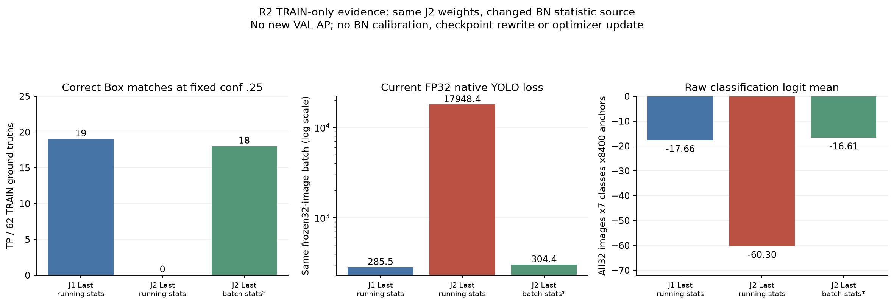

# Exp17-J2-R2：Zero-AP根因调查交接

状态：**EXP17_J2_R2_INVESTIGATION_COMPLETE_PENDING_CHATGPT_GATE**。科学解释：**HOLD_BN_MISMATCH_UPSTREAM_UNRESOLVED**。

## 结论及证据等级

已在冻结TRAIN输入上定位到能被控制干预解除的近因：**J2使用保存的BN running统计时发生train/eval归一化失配；同一学习权重改用当前batch统计后，检出及原生loss显著恢复。** 尚未确定失配形成原因、具体BN层、mean/variance各自贡献，或是否由Pair、裁剪、AMP及更新动力学引起。

这不是“已确认BN实现bug”，也没有修复正式模型。原100 Epoch、2100更新、80次VAL及Last MASTER Mask AP95=0保持原样；本轮不产生新的VAL/AP结果，不替换Best/Last/EMA。

## 同权重、同输入的关键对照

固定epoch0 batch1共32图、62GT；head始终eval，FP32、TF32关闭，conf=.25、NMS IoU=.7、类别一致IoU=.5匹配。

| 运行条件 | 检测数 | Box TP / FP / FN | 当前FP32 YOLO sum | 原始分类logit均值 |
|---|---:|---|---:|---:|
| J1 Last，running统计 | 24 | 19 / 5 / 43 | 285.4941 | −17.6562 |
| J2 Last，原running统计 | 0 | 0 / 0 / 62 | 17948.4102 | −60.3033 |
| J2 Last，仅BN改batch统计 | 24 | 18 / 6 / 44 | 304.3694 | −16.6127 |

J2原路径在conf=.25的NMS之前候选即为0，最大logit−4.8446（sigmoid约.00781）；不能归因NMS将正确候选吞掉。conf=.001仍有30个FP、0TP，所以不能说两个阈值都没有预测。BN干预后低阈值Box TP52，J1为54；GT最佳几何IoU均值从.00805升到.70945（J1 .73915），改善涉及几何预测，不只是越过置信度。

本次只统计Box匹配，**没有测Mask TP/AP或新VAL**。BN干预是一次性副本上的F.batch_norm(running=None)，不积累、不写回running统计，不改变affine参数或head eval，不保存模型。全部15个真实case的输入与持久state哈希前后相同。

## 运行路径与早期异常

- J1完整架构→fresh native、J2完整架构→fresh native、J2 fresh native→实际序列化native，以及J2直接fuse→实际AutoBackend，在本批次比较的decoded、原始scores/DFL、mask coefficient、proto均逐位相同。这里的完整架构是严格载入原Checkpoint的重建体，不冒充已退出的历史live对象。
- J2未融合→融合及J1 native→Backend有FP32数值差异，部分allclose标记不通过；两阈值下检测数和TP/FP/FN未改变。差异如实保留，不单凭标记判bug。实际Backend返回值也参与核对，并非只比较head hook。
- 原TRAIN中固定前两张不同来源图含2GT：J1得到3个检测/2TP，J2为0检测。这削弱了“只因增强packet或共同预处理坏掉”的解释，但不能排除所有输入分布或VAL特有路径问题。
- 同一32图上，Epoch5/10均9600个检测=32×300且全FP；Epoch15为76检测/0TP，Last EMA也为空。早期异常可在TRAIN重建态复现，不是全程无预测。只对final MASTER做了BN干预，不能声称所有早期异常的原因都已证明。

## 为什么训练loss下降仍会零AP

训练BN使用batch统计，正式推理使用running统计，训练loss下降不能认证推理状态健康。本次当前FP32对照中，J2的seg loss由423.1646降至3.2901，DFL由117.3204降至2.1827，cls由17.5858降至2.2475；foreground从P3/P4/P5=305/207/63变成413/157/15，均非零。这反驳了受测批次“完全没有正样本”或“整个head从未获得学习能力”的简单解释。

这些分量是本轮复用同一次raw输出计算的criterion结果，**不能补成历史box/seg/cls/DFL曲线**，也不能直接与历史AMP不同batch的均值作配对因果比较。原epoch100 YOLO均值280.6316、joint total303.3879；joint含SupCon8和Pair4，不是本轮YOLO诊断304.3694的同一量。

## CPU轨迹、裁剪与因果边界

25份Checkpoint以纯CPU tensor方式分析，未构造model/optimizer。参数与moments有限，J1/J2配置、类别、optimizer参数顺序及终态超参数一致；未见负/零BN running variance。J2全部BN variance L2是J1的7.55倍，部分层差异更大，例如model.16.m.0.cv1约1919.5倍。这些缓冲差异不能称为参数数值爆炸，也不能独立判BN错误。

B0 104→105由moments近似恢复的postclip梯度L2约9.99999982，实际参数增量与AdamW公式吻合；只验证这一步，不恢复2100步完整梯度。末轮两槽均是2100，所有physical训练字段相同，仅extra不同，不能误当2099→2100。

2100步100%触Clip10和既有80probe的Pair冲突继续保留，但正标量裁剪本身不改变当前梯度方向；AdamW更新也不是按clip系数简单缩放。已有probe中head的YOLO梯度非零，Pair/SupCon在head参数域为0，冲突可能通过共享上游间接影响。R2没有新增backward或参数更新，因此未建立Pair、Clip10或AMP导致BN失配的因果关系。

## 预算、保护与限制

R2独立账本38行，18次attempt/commit全部闭合：15次TRAIN模型前向、3次CPU构造器stride合成前向；余量0。新backward、optimizer更新、正式VAL、TEST、扩seed均0。14项标准库guard测试及59项独立完成审计全部通过。成功进程55.105秒，case计时合计29.091秒，峰值GPU allocated1,286,262,272字节，低于10GiB上限。阶段名为val的原生无增强输入组件只用于两张SHA绑定TRAIN图，不是新VAL pass。

442个关键原件前后bytes/SHA完全一致，原80claim及80evaluation集合和内容不变。C1生产源码、Protocol、Runtime、原授权、Claim/Seal、105与终态Checkpoint均未修改。前置metadata lazy-import拒绝及helper未消解configs/../dataset的词法路径拒绝均保留；后者只按原C1规范化政策修私有helper，未扩大668来源，且发生在任何授权/claim/forward之前。

本轮deterministic warn_only未设置CUBLAS_WORKSPACE_CONFIG，保留4条cuBLAS非确定性警告。逐位一致是当前实际观测，不宣称严格重跑保证；不为消除警告再消耗预算。原始候选未在80次历史VAL中完整保存，本轮TRAIN诊断不能逆向证明全部历史VAL运行态。

完整原始case、前向账本、18调用轨迹、脚本及其SHA、first2派生tensor保持私有；公开[摘要](results/exp17_j2_r2_zero_ap/summary.json)、[30行双阈值case表](results/exp17_j2_r2_zero_ap/train_diagnostic_cases.csv)、[路径比较](results/exp17_j2_r2_zero_ap/path_comparisons.json)、[CPU分析](results/exp17_j2_r2_zero_ap/CPU_TENSOR_FINDINGS.md)和[独立机制解释](results/exp17_j2_r2_zero_ap/INDEPENDENT_MECHANISM_REVIEW.md)。公开数据不授予任何执行权限。

## 停止与下一步建议

R2已达到“区分导出/评价封装与模型归一化状态”的目标：受测路径未显示独立导出/Backend故障，BN统计来源是已证实能改变失败行为的控制变量。**上游根因仍未决**，不能把它自动归类为框架bug、Pair方法无效或正式科研性能已恢复。

下一阶段仅建议先审查BN统计形成过程：A分支实际moment更新、训练与推理激活统计、漂移时间及detach A-stat假设的动力学影响，再决定是否批准新的有界TRAIN诊断。BN校准、模型修复、重训、VAL重评、Clip/lambda变更及追加seed都不在本轮执行范围。原科学负向观测完整保留，等待ChatGPT Result/Root-Cause Gate。
