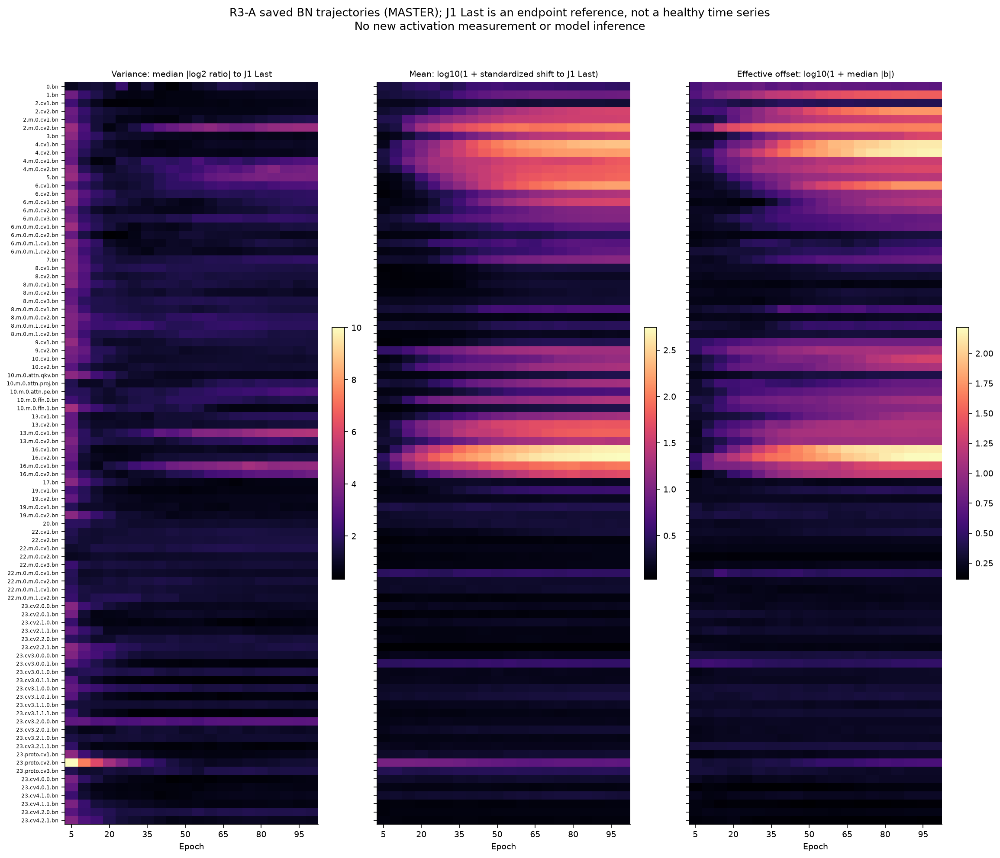
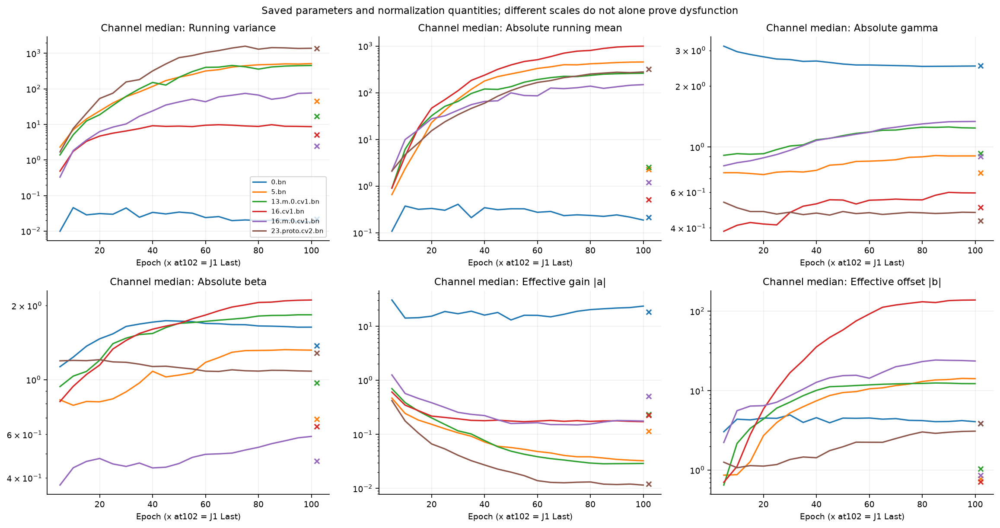

# Exp17-J2-R3-A：BN Running Statistics 漂移调查

状态：**EXP17_J2_R3_A_OFFLINE_ANALYSIS_COMPLETE_PENDING_CHATGPT_GATE**。科学解释继续保持 **HOLD_BN_MISMATCH_UPSTREAM_UNRESOLVED**。基线为 R2 提交 `e0a93f10111939e4b81012695e7109a693cdaaa7`。

## 主要结论

离线证据把调查重点从“全网Variance很大”推进到**共享Backbone及P3 Neck的参数、均值和有效归一化偏移共同变化**。其中，Neck的 `model.16.cv1.bn`、`model.16.cv2.bn` 均值变化尤其值得测量真实激活。尚不能证明Running Mean比Variance更能解释全零检测，也不能把这些变化直接归因Pair。

三个具体问题已澄清：

- **2101不是本次训练多做一次BN前向的证据。** 冻结COCO文件的90个BN计数均为1；按实际七类模型加载规则重建的初始BN buffer指纹为 `dc932431670c6b914da72dc9cb4e45343fc01f33d28344b171a6fd5c472b9835`，与既有J1准备记录一致。MASTER为加载初值1加2100次A更新；现有J1/J2计数一致。
- **EMA没有停止更新BN浮点统计。** 实际代码对浮点参数、running_mean、running_var执行EMA，整数计数不参与，因此EMA计数保留1。104→105的360个BN浮点tensor与原EMA公式吻合到FP32舍入水平。终态EMA紧随MASTER，没有离线可见的统计纠正。
- **Variance的全局L2由极端通道强烈主导。** J2全8040通道中，最大的1%（81个）贡献98.16%的Variance平方和；J1也有93.91%。J2/J1全局L2比7.55不能解释为每层或每个通道均增大7.55倍。

正式结果仍为100 Epoch、2100次有效更新、80次VAL、Last MASTER Mask AP50–95=0，较J1下降27.2743879855 pp。本轮没有新的预测、AP或修复模型。

## 数据和方法

读取R2绑定的25份Checkpoint来源：20个periodic、旧104/105、终态双槽和J1 Last。终态双槽同为2100，不当作相邻更新；去重后的统计表包含23个状态记录。每个模型90个BN、8040个通道，两角色共369840条通道记录；另有160800条MASTER区间统计推导、2100步记录和80个既有梯度probe。

逐层记录Mean、Variance、gamma、beta的精确通道分位数，以及有效增益 `a=gamma/sqrt(var+.001)` 和有效偏移 `b=beta-a*mean`。90个BN均通过实际序列化模块结构匹配前置Conv和通道数。Conv与BN参数、buffer均分开统计。

网络分区固定为Backbone0–10、Neck11–22、Head23；P3共享前缀包括Neck13和16。原诊断名为backbone的汇总仅指0–10，不能把它当作整个辅助梯度范围。使用原Gram矩阵重算Pair4、SupCon8和联合梯度，未新增backward或重建历史梯度。

初值是按冻结COCO与实际加载规则推导的buffer，不冒充新发现的初始化Checkpoint；其BN整体指纹另与原准备记录验证。区间输入统计由相邻buffer和固定momentum反推，明确标为推导值，不是实测激活。所有区间推导方差为正，最小约4.6694e-6；这不构成BN更新数值全程正确的独立证明。

## 十个科研问题

### 1. 最早何时出现漂移？

最早保存的训练状态在Epoch5。相对初始化的描述性标记，J2此时85/90层有至少2倍的通道中位尺度变化，71/90层有至少一个初始标准差的均值偏移。**这些不是病理判据**：正常得到非零AP的J1 Last也分别有89/90和85/90层达到同样标记。

相对Epoch5，重点层在Epoch10已经出现并在Epoch15持续的变化；例如Neck13、16及Backbone5。无法定位Epoch1–4的起点，也无法证明统计漂移先于首次检测失效：正式AP在Epoch5已为0。初始尺度变化、持续训练变化和导致推理失败的失配必须区分。

### 2. 哪些层最严重？

没有唯一可替代功能检验的严重度排名：

| 排名口径 | 主要位置 | 观察 |
|---|---|---|
| 终态Variance绝对L2 | `model.5.bn` | L2约216580；强烈影响全网L2 |
| 相对J1的稳健通道Variance差异 | `model.13.m.0.cv1.bn`、`model.2.m.0.cv2.bn`、`model.16.m.0.cv1.bn` | 中位绝对log2比例约5.06、4.55、4.41 |
| 相对J1的标准化Mean差异 | `model.16.cv2.bn`、`model.16.cv1.bn` | 中位绝对偏移约554、474个J1标准差 |
| Epoch5→100的Variance中位增长 | `model.23.proto.cv2.bn` | 约822倍，但终态中位数1387.29与J1的1391.22接近，不能据增长排名判其为病因 |

### 3. Mean还是Variance更异常？

两者均有变化，但**Mean及其有效偏移是R3新增的高优先级线索**。例如以下数值都是通道中位数：

| BN | 指标 | J1 Last | J2 Last |
|---|---|---:|---:|
| `model.16.cv1.bn` | 绝对Running Mean | 0.5073 | 996.1821 |
| 同层 | Running Variance | 5.0786 | 8.6736 |
| 同层 | 绝对有效偏移b | 0.7081 | 138.6543 |
| `model.16.cv2.bn` | 绝对Running Mean | 1.1616 | 770.0421 |
| 同层 | Running Variance | 2.0189 | 4.9490 |
| 同层 | 绝对有效偏移b | 0.8484 | 163.4931 |

此处比较的是两个训练模型保存的统计，不是同一个J2模型的“running值减真实当前输入统计”。较大的b也可能与较大的输入均值相消；因此不能仅靠该表认定Mean就是功能失效主因。R3-B需要分别替换Mean与Variance。

### 4. 哪个网络区域最值得关注？

建议优先测量**Backbone到P3 Neck的传播，特别是Neck13/16**。Backbone5主导绝对Variance能量，Neck16的Mean/有效偏移差异更突出。Head并非没有变化，但proto的大幅增长也出现在J1，且已有probe中Head没有直接Pair/SupCon参数梯度，不能优先宣布检测头自身损坏。

### 5. Affine和前置Conv是否同步变化？

是，保存状态中可见同步变化，但并非简单的gamma统一爆炸。Epoch5→100：

- `model.16.cv1.conv.weight` L2从8.7087增至166.5070；通道RMS中位数从0.0651增至1.0020。对应BN的绝对gamma中位数从0.3845到0.5941，绝对beta从0.8158到2.1084。
- `model.5.conv.weight` L2从14.0924增至141.5767，但等效融合权重的通道L2中位数从0.5642降到0.2052：running方差和affine共同影响结果，原Conv变大不等于推理增益同比变大。
- BN affine实际Weight Decay为0；前置Conv所在权重组为0.0005。相邻实际参数增量完整保存为派生表，没有用两个L2的差代替增量范数。

### 6. EMA是否继承或缓解问题？

EMA终态继承了非常接近的统计。90层中，EMA对MASTER的标准化Mean偏移中位数最大约0.06454；Variance绝对log2比例中位数最大约0.005589。结合R2的EMA无检出观察，没有看到它缓解失败行为。

实际EMA衰减是 `0.9999*(1-exp(-updates/2000))`，Epoch5约0.05114，Epoch100约0.65000，不能按固定0.9999臆测一个极慢EMA。BN自身momentum为0.03，半衰期约22.76个更新，95%权重范围约98.35个更新。

104→105公式对照最大绝对残差约4.66e-5，最大带尺度保护的相对残差约3.89e-6，符合保存FP32状态的舍入尺度。该检查覆盖一个连续更新，不冒充2100步EMA重放。EMA权重与平均后的BN buffer是否适配其真实激活，仍未测量。

### 7. Clip10与漂移有何时间关联？

2100步全触发裁剪已由原范数和系数核对，故不存在“裁剪/未裁剪”组间比较。Epoch5到100，梯度范数均值约180.85→161.43，clip系数均值约0.06091→0.06393，而若干层统计继续明显变化；不能用当步范数一直恶化解释全部漂移。

按预先限定的5-Epoch区间一阶差分计算描述性Spearman。例如Neck对数绝对Mean变化，与clip系数变化的同期相关约0.381，与范数约−0.319；均只有19个差分点，无独立因果对照，不作显著性或致因声明。全部预定关联而非只挑最大项均已交付。

裁剪不改变当步联合梯度方向；AdamW的历史moments和分量归一化使参数更新不能按clip系数直接缩放。保存moments的代数proxy显示部分Conv的自适应项显著大于当下纯衰减项，例如终态 `model.16.cv1.conv.weight` 两者L2约0.01002和0.00001657；这不是新执行的一步，也不能分解为Pair贡献。

### 8. Pair是否可能间接影响A特征尺度？

存在**路径和方向上的间接支持**，尚无因果确认：

- 80个probe中，Pair4/(YOLO+SupCon8)范数比的中位数为Backbone约7.88%、Neck约11.42%；Pair与YOLO负余弦分别52/80、26/80。原52/80的backbone统计不能推广为每个区域。
- 按每个probe的Pair梯度平方范数份额再取均值，`model.0`约46.49%、`model.4`约25.19%、`model.16`约15.09%。这是梯度能量分布，不是各层对BN漂移的因果贡献率。
- 原 `replay_a` 在N上把A的均值/方差detach成常量，保留共享参数梯度；该梯度对平移或尺度方向的处理与完整TRAIN BN的统计求导不同。因此“辅助梯度推动某些主任务BN归一化较不敏感的方向”是值得检验的机制假设。

没有保存逐BN通道的组件梯度或真实激活，因此不能验证上述方向是否实际造成Mean漂移。YOLO、SupCon、AdamW及固定统计回放的共同作用均未被分离。

### 9. 能否排除BN实现错误？

目前没有发现计数、初值加载、N额外buffer更新、终态eps/momentum或EMA漏更新这几类错误的证据。实际代码与保存状态支持A每步更新一次、N不更新持久buffer；eps=.001、momentum=.03、track_running_stats=True。

但计数和SHA无法还原每步输入激活。区间统计反推本身也不是独立观测，所以不能宣称已排除全部BN实现、AMP数值或运行时问题。R1隔离修复证据继续继承，不重做其验证。

### 10. 必须通过什么新诊断回答？

需要测量同一J2状态下各BN真实输入统计，并通过Mean-only、Variance-only对照区分功能影响。离线证据不足以回答“保存统计与当前激活相差多少”“上游改变如何放大到下游”和“哪种统计替换足以恢复行为”。

推荐下一步仅申请**4次R3-B TRAIN前向**：原统计带hook、Mean-only、Variance-only、两者batch统计带hook。暂不申请额外区域扫描或EMA对照。详细边界见 [R3-B待审方案](results/exp17_j2_r3_bn_drift/R3_B_PROPOSAL_NOT_AUTHORIZATION.md)。本轮R3-B执行与授权均为0。

## 证据等级与限制

已确认：加载初值解释计数；逐层/逐通道buffer和参数确实变化；少量通道主导全局L2；P3 Neck均值/偏移突出；EMA浮点buffer更新且终态接近MASTER；辅助梯度确实到达共享Neck。

被证据反驳的简单解释：2101必然意味着多一次本次训练前向；EMA的整数计数1意味着EMA未更新；所有层都同幅度膨胀；仅看增长最大层即可定位病因；Pair直接更新原生Head参数。

仍成立的假设：共享特征持续漂移、Mean/Variance跟踪或传播失配、参数与buffer时间配套差异、detach A-stat辅助梯度与优化器共同改变尺度。证据不足：Pair、Clip10或EMA是唯一原因；早期与终态失败具有完全相同机制；存在某个已确定的框架bug。

本轮不产生新的Mask/VAL结果，不调整阈值、科研参数或BN。25个来源的稀疏保存只能给出有限时间分辨率；80个probe是20时点×4个固定batch，不是80个独立训练时点。Pair距离的附表为anchor描述均值，不替代正式按类/来源组归约的Pair Loss。

## 验收与交付

- CPU数值fixture 12项通过；另108项交付核验通过，包括2700项直接tensor到CSV的分位数对照。
- 476个已载入Module类的构造器/forward保护保持启用；额外保护反向、优化器、模型保存和功能式Conv/BN调用。成功分析的禁止调用计数全为0，CPU RNG未变，CUDA未初始化。
- 原442个受保护文件与全部本轮输入SHA保持一致；原25份Checkpoint、C1源码、训练/VAL授权、Claim/Seal及R2账本均未修改。
- 两个首版CPU读取器分别因严格导入保护拒绝NumPy惰性模块加载而停止；保留原脚本、日志和部分输出。修订仅在保护进入前显式导入 `numpy.ma`，没有弱化保护，未发生模型前向或预算消费。
- 完整逐通道CSV、分析脚本、原始来源清单和失败记录保留私有；公开聚合CSV、五组PNG/SVG、机器摘要和机制证据清单。生产源码无变化，无需C0/C1身份迁移。

完成R3-A后停止。原正式负向观察保持不变，等待用户和ChatGPT审查；不自动进入R3-B、校准、训练或重新VAL。
