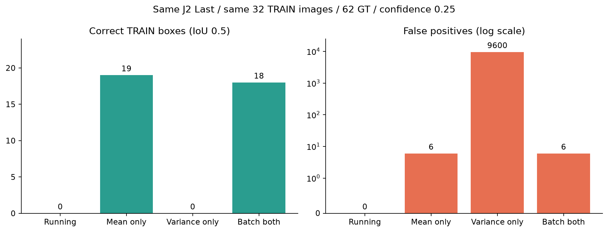
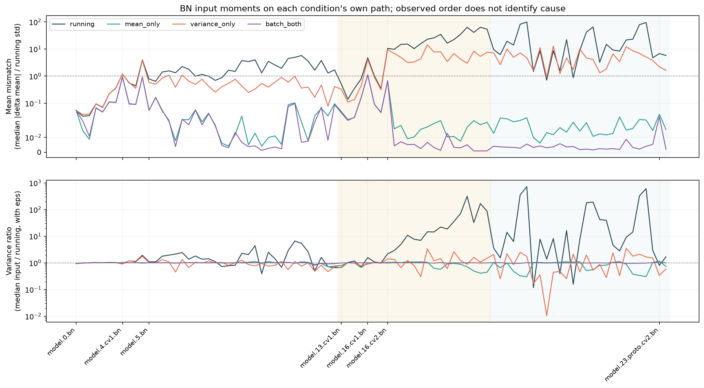

# Exp17-J2-R3-B：BN Mean / Variance 来源对照

状态：`EXP17_J2_R3_B_FOUR_FORWARD_COMPLETE_PENDING_CHATGPT_GATE`。科学解释：`HOLD_MEAN_MISMATCH_UPSTREAM_UNRESOLVED`。基线提交 `a4ffa726cf2b42a9f47640764694275ec679dd66`，执行时间2026-11-24 15:29（Asia/Shanghai）。

## 核心结论

**同一J2 Last MASTER、同一冻结TRAIN batch，保留所有权重及Running Variance，仅把全网BN的Mean来源改为各层当前输入的batch均值，就恢复了正确检测。仅替换Variance不能恢复。** 这把R2的“BN统计来源有关”推进到更具体的Mean干预功能证据。

该结论限定于32张TRAIN、62个GT、FP32、TF32关闭的四个独立副本。没有新的VAL、Mask AP或修复模型；原正式Last MASTER Mask AP50–95=0及80次VAL永久保留。尚未证明哪个局部层段足以纠正，也未证明Pair、Clip10或BN实现错误造成训练中的失配。

## 四次前向结果

固定conf=.25、NMS IoU=.7、max_det=300、七类一致IoU=.5一对一Box匹配：

| 条件 | Mean来源 | Variance来源 | 检测数 | Box TP | Box FP | Box FN |
|---|---|---|---:|---:|---:|---:|
| Running | 原running | 原running | 0 | 0 | 0 | 62 |
| Mean-only | 当前batch | 原running | 25 | **19** | 6 | 43 |
| Variance-only | 原running | 当前batch | 9600 | **0** | 9600 | 62 |
| Batch-both | 当前batch | 当前batch | 24 | **18** | 6 | 44 |

在既定conf=.001下，四组TP依次为0、53、0、52；检测数为30、4799、9600、4657。两阈值均来自同一份raw输出，没有增加前向或调阈值。Mean-only的19与Batch-both的18仅是该批次计数，不能据此宣布某种BN策略性能更优。

Variance-only在每张图都达到300上限，全部FP，分类集中于Tears和Tip curl（5097、4503）。这与早期Epoch“达到max_det且全FP”的表象相似，**不证明两者有相同根因**。

原始分类logit均值分别为−60.3033、−16.6584、−96.7940、−16.6127；最大值分别为−4.8446、2.3571、50.0377、2.4752。Mean-only同时恢复几何匹配：低阈值下GT最佳几何IoU均值约0.71195，原Running为0.00805，Batch-both为0.70945，不能将恢复只解释为跨过置信度门限。

## 实际激活说明了什么

每个条件记录90个BN、8040个通道的实际输入Mean/有偏Variance、原running统计、gamma/beta、BN输出矩；合计32160条通道记录。

定义描述量 `|当前输入Mean − Running Mean| / sqrt(Running Variance + eps)`，对通道取中位数。它度量同一模型当前路径的统计偏差；不同于R3-A中J2与J1两个模型之间的buffer比较。

| 位置 | 原Running路径 | Mean-only路径 | Batch-both路径 |
|---|---:|---:|---:|
| `model.0.bn` | 0.0549 | 0.0549 | 0.0549 |
| `model.4.cv1.bn` | 1.1971 | 0.9234 | 0.9400 |
| `model.5.bn` | 0.7887 | 0.0549 | 0.0549 |
| `model.16.cv1.bn` | 4.7668 | 1.1245 | 1.1228 |
| `model.16.cv2.bn` | 10.5384 | 0.6719 | 0.6786 |

原Running路径有68/90层的该描述量大于1；Mean-only及Batch-both各仅1层。执行顺序中首次超过1的是第8个BN `model.4.cv1.bn`。这是人为说明尺度下的首个越界位置，**不是训练时间起点或已确定的致因层**。四组在首层BN的实际输入矩逐通道一致。

下游差异更大：原Running的 `model.23.cv2.2.1.bn` 均值偏差中位数约98.92个running标准差，输入/run方差比中位数约721；BN输出RMS中位数约294.41。纠正Mean后，下游路径的偏差显著减少。这支持失配随网络传播和放大的解释，但局部必要性/充分性尚未测试。

一个重要修正：**Neck16的绝对Mean接近1000，本身并不等于错误。** `model.16.cv1.bn` 的原Running Mean绝对值中位数996.18，Batch-both路径的实际输入Mean约1000.13；Mean-only约1000.16，原Running路径约1015.75。原running方差中位数8.6736，Batch-both实际输入方差8.6715，说明“Variance很大，所以必须缩小”不是本批次的功能解释。

均值需按通道差和对应标准差理解，不能把两个中位数直接相减当作通道误差。Mean-only虽然保留所有running方差，实际下游输入方差仍会随上游归一化变化；它不是把网络各层真实方差固定住的独立因子实验。

## 实现、身份和验收

用户在解释四次对照后明确回复“好的继续进行”，据此生成本轮独立工程授权；没有声称取得不存在的外部签名。R3-A待审方案原字节另存，原Training/VAL Authorization、Claim/Seal、Protocol、Runtime和C1生产代码均未改写。

- Last MASTER文件SHA：`063e473cf0b878f105c85790be47332a30d8192e09a14ad28ab2180b85ba6e2d`；native state SHA：`d222a70d7570680459359a36a682312690b052cc10197f4916ec1df66492782f`。
- TRAIN packet SHA：`802114bde743ce7c58e997be279987148f33d91898d43b511ad5040939edd929`；沿用原668 TRAIN身份与增强后tensor校验，没有解码新图像。
- 直接读取可信序列化模型；构造器合成前向0。每次独立deepcopy，非BN模块及Head保持eval，原输入、参数、BN buffer与模式前后哈希/记录一致。
- Mean-only/Variance-only使用临时函数式eval归一化；Batch-both使用原R2函数式batch归一化。均不写持久running统计、不校准、不保存模型。
- 使用每一条路径自己的输入统计，未把原Running的下游统计固定移植到其他路径。FP32混合统计与原生batch统计的舍入路径差异保留；实测BN输出矩与代数表达式的最大带尺度保护残差约4.91e−5（Mean）、2.54e−6（Variance）。
- 全部模型前向在独立hash-chain账本中先ATTEMPT、后结果SHA/COMMIT；4次attempt和4次commit闭合，账本共10行，剩余额度0。没有隐式前向或自动重试。
- 设置 `CUBLAS_WORKSPACE_CONFIG=:4096:8`，严格确定性算法、AMP关闭、TF32关闭。运行stderr为空。GPU峰值allocated为1269120512字节（约1.18GiB），诊断及其结果提交约21.79秒，进程总计约28.32秒。
- 14项CPU算术/预算测试、66项独立完成核验通过；CPU独立重算8组逐图TP/FP/FN一致。451个原件SHA未变，包含原442项及本轮额外依赖。
- Running与Batch-both保存的前两图decoded、scores、DFL、mask coefficients、proto均与原R2对应文件逐位一致；不是重新消耗R2预算。
- 首版后处理核验因保护拦截框架导入时的类级SiLU初始化而停止；在v2中将已有类定义导入放到保护前，模型调用保护保持不变。原脚本与失败日志保留，四次GPU调用未重跑。

## 当前科学判断和下一步

已确认：在这批数据上，全网Mean替换足以恢复Box检测；全网Variance替换不足。全网variance增大不是单独充分的失败解释；原buffer与当前输入在推理路径中的偏差及传播值得重点追查。

仍未知：哪些局部层段的Mean纠正足够；为什么训练得到对这种偏差敏感的状态；Pair/replay_a、SupCon、AdamW、Clip10及统计跟踪滞后各自作用；早期与终态失败是否同因。不能从本批次恢复推导正式VAL或Mask AP恢复。

下一步建议先提交**两次局部Mean对照**审查：只在共享0–16前缀纠正Mean、只在剩余17–23纠正Mean，其余使用原running统计。这样区分两段纠正的充分性，避免立刻扫描90层或重新训练。详细预算与判读见 [R3-C待审建议](results/exp17_j2_r3b_bn_sources/R3_C_PROPOSAL_NOT_AUTHORIZATION.md)。本轮不生成R3-C授权、不执行额外推理。

完整原始逐通道记录、四组raw切片/NMS预测、独立账本、授权、脚本及失败证据留在私有归档；公开逐层汇总、8行双阈值结果表、3组图表与机器摘要。原正式负向观察保持不变。
