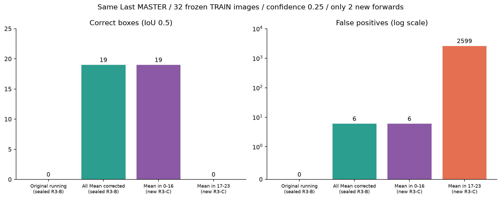
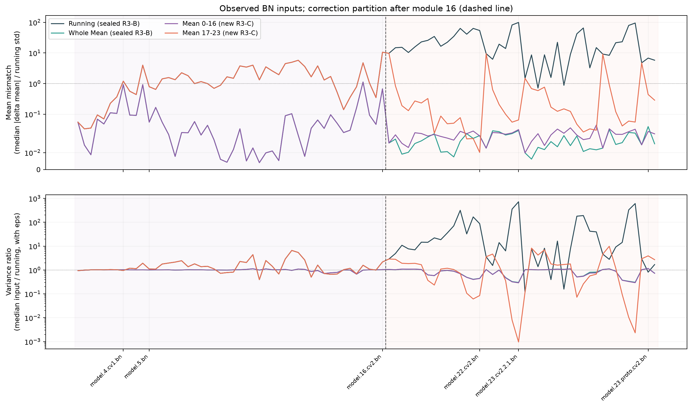

# Exp17-J2-R3-C：局部BN Mean干预与共享前段定位

状态：`EXP17_J2_R3_C_TWO_FORWARD_COMPLETE_PENDING_CHATGPT_GATE`。科学状态：`HOLD_SHARED_PREFIX_MEAN_MISMATCH_UPSTREAM_UNRESOLVED`。基线提交 `200efe5eee56852af39b6339ad84babb1438543d`。执行时间2026-11-24 16:09–16:10（Asia/Shanghai）。

## 结论与边界

**在同一Last MASTER、同一冻结32张TRAIN/62个GT上，仅纠正共享0–16模块的BN Mean，即恢复19个正确Box、6个FP；后段17–23保持全部原running统计。仅纠正后段，在固定conf=.25下仍为0个正确Box、2599个FP。**

因此，R3-B的全网Mean干预已缩小为共享前段48个BN的局部充分性证据。0–16包含Backbone与P3 Neck，不能称为纯Backbone。本轮没有证明最小致因层、必要性、Pair因果关系，或正式VAL性能恢复。原正式100 Epoch、2100更新、80次VAL和Last MASTER Mask AP50–95=0完整保留。

## 两次前向结果

两次新调用均使用各自当前路径的batch Mean；所有90个BN的Variance始终使用原Running Variance。未选中BN的Mean使用原Running Mean。独立副本、FP32、AMP/TF32关闭，原参数与buffer不写回。

NMS IoU=.7、max_det=300；七类一致、IoU=.5的一对一Box匹配沿用冻结规则。下表均为TRAIN描述统计，不是Mask AP或VAL。两个阈值来自同一份raw输出，不增加模型调用。

| 条件 | 来源 | 纠正BN数 | conf | 检测数 | TP | FP | FN |
|---|---|---:|---:|---:|---:|---:|---:|
| 原Running | R3-B封存 | 0 | .25 | 0 | 0 | 0 | 62 |
| 全网Mean | R3-B封存 | 90 | .25 | 25 | 19 | 6 | 43 |
| **仅0–16 Mean** | **R3-C新增** | **48** | **.25** | **25** | **19** | **6** | **43** |
| 仅17–23 Mean | R3-C新增 | 42 | .25 | 2599 | 0 | 2599 | 62 |
| 原Running | R3-B封存 | 0 | .001 | 30 | 0 | 30 | 62 |
| 全网Mean | R3-B封存 | 90 | .001 | 4799 | 53 | 4746 | 9 |
| 仅0–16 Mean | R3-C新增 | 48 | .001 | 4903 | 53 | 4850 | 9 |
| 仅17–23 Mean | R3-C新增 | 42 | .001 | 8630 | 17 | 8613 | 45 |

前段干预与全网干预在固定阈值下计数相同，**不意味着raw输出或检测框逐位相同**。后段干预在低阈值下有17个TP，不能概括成“完全没有定位能力”；但其固定阈值输出全部是FP，未恢复该口径的检测功能。

忽略类别的GT最佳几何IoU均值，在conf=.001时为：原Running 0.008047、全网Mean 0.711946、仅前段0.717339、仅后段0.455557。前段恢复也反映在几何上，不能仅解释为分数跨过门限；低阈值的大量FP仍需如实保留。

## 逐层激活与失配传播

每次记录90个BN、8040个通道的真实输入/输出矩、所选统计、原running统计和仿射参数，共16080条新增通道记录。R3-B两组参照只读复用。

前48个BN、4712个通道的六种矩逐项严格相等：仅前段干预对应封存全网Mean；仅后段干预对应封存原Running。该证据支持新旧输入、前段调用和干预边界的一致性。

以 `|实际输入Mean − Running Mean| / sqrt(Running Variance + eps)` 的通道中位数描述偏差：

| BN位置 | 原Running | 仅0–16 Mean | 仅17–23 Mean |
|---|---:|---:|---:|
| `model.16.cv2.bn` | 10.5384 | 0.6719 | 10.5384 |
| `model.17.bn` | 9.7338 | 0.01563 | 9.7338 |
| `model.22.cv2.bn` | 53.9923 | 0.01981 | 0.01012 |

`model.17.bn`是后段的第一个BN。前段纠正使其输入偏差显著降低，即使该BN自身未改Mean来源；其输入/run方差比也从2.8881降至1.0490。这是上游干预改变下游输入的直接记录。

`model.22.cv2.bn`在仅前段干预时，输入/run方差比从87.4084变成0.43985，输出RMS从57.5720降至1.11865。仅后段干预虽然同样降低该层Mean偏差，却使其输入/run方差比为0.08489，输出RMS为0.89930，且最终固定阈值TP仍为0。**只看某层Mean偏差变小不足以判断功能恢复。**

这些观察支持“前段失配沿网络传播并影响后段功能”的解释。仍不能确定最初是哪一层、训练中的哪个过程造成失配；局部干预可能形成补偿路径。上游Mean变化也改变下游实际Variance，并非各层真实Variance固定的正交因子实验。

沿用R3-B修正：绝对Mean约1000本身不是缺陷证据。需要比较同一路径、同一通道的输入与running统计。图中阈值1仅用于描述，不是训练故障判据。

## 身份、执行与验收

用户明确批准继续两次局部Mean对照，据此物化本轮独立工程授权；不声称额外取得外部签名。原R3-C建议原字节另存，原Training/VAL授权、Claim/Seal、Protocol、Runtime、生产源码及历史账本保持不变。

- Last MASTER文件SHA：`063e473cf0b878f105c85790be47332a30d8192e09a14ad28ab2180b85ba6e2d`；native state SHA：`d222a70d7570680459359a36a682312690b052cc10197f4916ec1df66492782f`。
- TRAIN packet SHA：`802114bde743ce7c58e997be279987148f33d91898d43b511ad5040939edd929`。复用原668 TRAIN allowlist与冻结张量；无新图像解码。
- 直接读取可信序列化模型，每次独立deepcopy；构造器/合成前向0。非BN模块及Head保持eval，模型状态、输入和模块模式前后不变。
- 精确范围48/42BN，全网Variance均为原running；原492个受保护文件SHA不变，包括R3-B封存产物及manifest。
- `CUBLAS_WORKSPACE_CONFIG=:4096:8`、严格确定性；账本6行、2次ATTEMPT及2次COMMIT闭合，剩余额度0。无自动重试。
- 20项针对性CPU测试通过；40项独立完成核验全部通过。CPU从保存的NMS数组独立重算四组逐图TP/FP/FN，结果一致，无额外模型调用。
- BN输出矩与代数表达式的最大带尺度保护残差：Mean约3.30e−5、Variance约1.97e−6。原gamma/beta/running统计与封存参照逐项一致。
- 诊断及提交约11.50秒，进程总计约17.90秒；GPU峰值allocated 1269120512字节（约1.18GiB）。CPU/GPU进程正常退出；GPU前向及独立核验stderr为空，CPU unittest的stderr为正常20项PASS输出，没有失败调用。
- 无backward、optimizer update、校准、模型保存、VAL/TEST。原训练2100步和正式80次VAL预算未增减。

机器身份及验收见 [execution_bindings.json](results/exp17_j2_r3c_local_mean/execution_bindings.json)、[verification_summary.json](results/exp17_j2_r3c_local_mean/verification_summary.json)。完整逐通道记录、raw切片、NMS数组、授权、账本、测试和源码留在私有归档。

## 下一步与科学判读

现已定位到“纠正共享前段Mean足以恢复这一批数据的Box功能”，但还没回答“为什么训练产生这种状态”。Pair、SupCon、replay_a、统计跟踪与优化/裁剪各自的作用仍未确定，不应据此宣布J2方法失败或Pair导致BN污染。

下一轮建议仅两次前向，将前段拆为**Backbone 0–10（40BN）**与**P3 Neck 11–16（8BN）**。后段17–23均保留原running统计，其他身份和规则不变。对照局部充分性，避免直接扫描90层或重训；详细判读见 [R3-D待审建议](results/exp17_j2_r3c_local_mean/R3_D_PROPOSAL_NOT_AUTHORIZATION.md)。本轮未生成R3-D授权、未执行该范围。

交付包括8行双阈值结果、360行新旧参照逐层汇总、2组图表、机器摘要、完整及审查私有包。旧G4未提交改动保持原样。原正式零AP结果和工程调查结论分开报告，等待结果审查。
