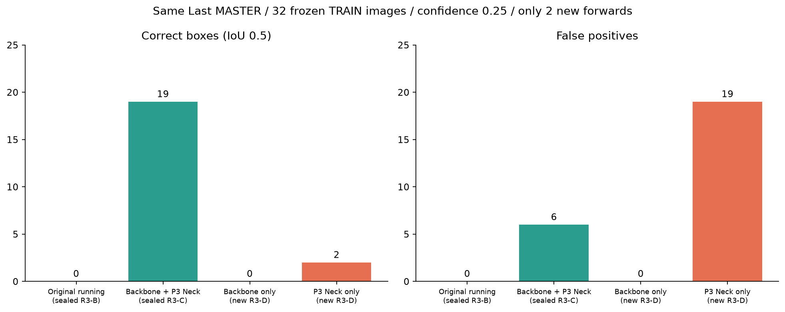
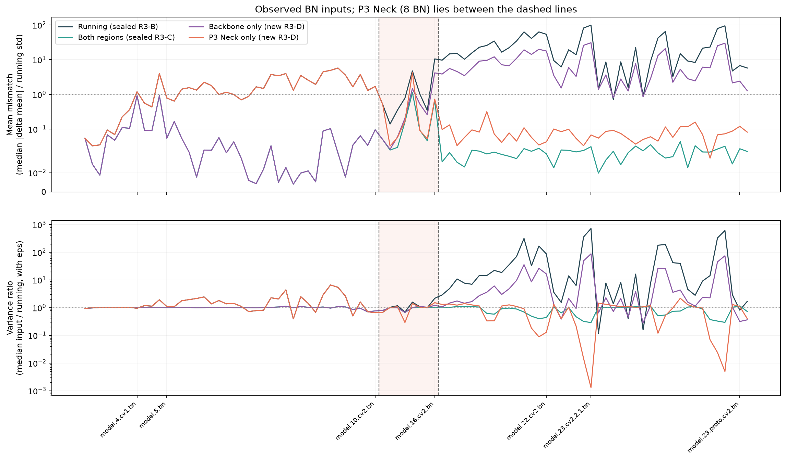

# Exp17-J2-R3-D：Backbone / P3 Neck Mean分段对照

状态：`EXP17_J2_R3_D_TWO_FORWARD_COMPLETE_PENDING_CHATGPT_GATE`。科学状态：`HOLD_COMBINED_PREFIX_MEAN_DEPENDENCE_UPSTREAM_UNRESOLVED`。基线提交 `6a6ae5055d83db8b4d03f670ae018dba8eef9d1b`；执行时间2026-11-24 16:36（Asia/Shanghai）。

## 本轮结论

**共享前段的两部分不能简单互相替代。仅纠正Backbone 0–10的Mean，固定conf=.25仍无检测；仅纠正P3 Neck 11–16，得到2个正确Box、19个FP。先前联合纠正两段得到19个正确Box、6个FP。**

这组同模型、同输入、同后处理的对照支持：在已测试的干预中，两段联合纠正有明显更好的功能表现。不能把它升级成“每个BN都必要”“两个区域均有独立实现bug”或“Pair已被证明是原因”。P3 Neck单独干预有部分恢复，不是完全无效。

近端问题已得到干预支持：原running统计参与的推理路径与该模型当前激活不匹配，均值来源改变可恢复部分Box功能。**训练为何产生这种敏感状态，仍未确定。** 原正式100 Epoch、2100更新、80次VAL和Last MASTER Mask AP50–95=0不变。

## 范围与结果

实际模型有90个BN、8040通道。新调用分别选择40个Backbone BN和8个P3 Neck BN；后者实际位于模块13、16，各4个BN。模块11/12/14/15没有BN。其余42个BN始终保留原running统计。所有条件的Variance来源均是原Running Variance，Mean替换使用各自当前路径的batch均值。

同一冻结32张TRAIN、62个GT，FP32、AMP/TF32关闭；NMS IoU=.7、max_det=300，七类一致、IoU=.5一对一Box匹配。两阈值使用同一次raw输出，未调阈值、未追加模型调用。

| 条件 | 来源 | conf | 检测数 | TP | FP | FN |
|---|---|---:|---:|---:|---:|---:|
| 原Running | R3-B封存 | .25 | 0 | 0 | 0 | 62 |
| Backbone＋P3 Neck Mean | R3-C封存 | .25 | 25 | 19 | 6 | 43 |
| **仅Backbone Mean** | **R3-D新增** | **.25** | **0** | **0** | **0** | **62** |
| **仅P3 Neck Mean** | **R3-D新增** | **.25** | **21** | **2** | **19** | **60** |
| 原Running | R3-B封存 | .001 | 30 | 0 | 30 | 62 |
| Backbone＋P3 Neck Mean | R3-C封存 | .001 | 4903 | 53 | 4850 | 9 |
| 仅Backbone Mean | R3-D新增 | .001 | 42 | 0 | 42 | 62 |
| 仅P3 Neck Mean | R3-D新增 | .001 | 5235 | 31 | 5204 | 31 |

低阈值下忽略类别的GT最佳几何IoU均值依次为0.00805、0.71734、0.01305、0.55452。Neck单独干预保留部分几何定位能力，但不能据此替换正式评价或宣布分割性能恢复。

原始分类logit均值分别为−60.3033、−16.6062、−29.5450、−16.3177；最大值为−4.8446、2.3520、−2.6477、1.8203。Neck单独干预与联合干预的均值相近，却有明显不同的TP/FP，说明分类分数汇总不能代替正确定位、类别匹配与逐图检查。

## 离线激活证据

新增两组共16080条逐通道记录；结合两组历史参照，共360行逐BN汇总。对新旧参照的严格比较确认：

- 仅Backbone干预的前40个BN、4184通道，六种输入/输出/选中统计矩与R3-C联合干预完全相等。
- 仅Neck干预的同一前40个BN，与R3-B原Running完全相等。
- 两组到第一个Neck BN `model.13.cv1.bn` 的输入Mean和Variance仍分别与上述参照逐通道相等。因此观察到的后续差异符合干预边界，未发现输入身份或上游计算路径变化。

以下是 `|实际输入Mean − Running Mean| / sqrt(Running Variance + eps)` 的通道中位数；它描述当前路径偏差，不是故障阈值或训练时间起点：

| 位置 | 原Running | 联合纠正 | 仅Backbone | 仅P3 Neck |
|---|---:|---:|---:|---:|
| `model.13.cv1.bn` | 0.52136 | 0.05054 | 0.05054 | 0.52136 |
| `model.16.cv1.bn` | 4.76681 | 1.12451 | 1.47307 | 4.22741 |
| `model.16.cv2.bn` | 10.53843 | 0.67185 | 4.18112 | 0.73145 |
| `model.17.bn` | 9.73385 | 0.01563 | 3.87283 | 0.09779 |
| `model.23.cv2.2.1.bn` | 98.92236 | 0.03133 | 30.84209 | 0.06818 |

仅Backbone纠正后，Neck入口偏差已经较小，但Neck16及其后续路径仍放大偏差。`model.16.cv2.bn`输出RMS中位数为3.0011，联合纠正为0.92873；所列检测头BN输出RMS为92.6096，联合纠正为1.6589。这使Neck16成为进一步局部干预的优先位置，但不能据此排除Neck13或skip/concat输入的作用。

仅Neck纠正则呈另一种状态：所列检测头BN的Mean偏差较小，但输入/run方差比中位数仅0.00131，联合纠正为0.29017、仅Backbone为87.8989、原Running为721.0003；对应输出RMS为0.22773。该例说明**消除较大的Mean偏差并不自动恢复合适的下游激活分布**。它不证明单独的Variance缺陷；上游Mean干预本身会改变下游真实方差。

本轮组成四种“Backbone Mean / Neck Mean”条件。计数差异是这一批次的功能观察；不能将非线性TP差值当成统计显著的交互效应，也不能用联合条件较好推断两段所有BN的必要性。所有分支都使用其当前输入均值，没有移植另一分支的下游统计。

## 身份与验收

用户明确批准R3-D两次范围，依据该批准生成独立工程授权和账本；没有额外外部签名主张。旧R3-D建议原字节另存。继承R3-C运行器，仅改独立目录、两段精确选择和历史证据绑定，生产C1代码不变。

- Last MASTER文件SHA：`063e473cf0b878f105c85790be47332a30d8192e09a14ad28ab2180b85ba6e2d`；native state SHA：`d222a70d7570680459359a36a682312690b052cc10197f4916ec1df66492782f`。
- TRAIN packet SHA：`802114bde743ce7c58e997be279987148f33d91898d43b511ad5040939edd929`。原Protocol、Runtime、Training/VAL授权、Claim/Seal、Checkpoint、历史日志和预算保持不变。
- 522个原件SHA一致，包含已封存R3-C产物。每次独立deepcopy，模型参数、BN buffer、输入张量及模块模式前后一致；没有新图像解码。
- 21项CPU算术/范围/账本测试通过，CPU preflight无构造器和模型前向、无CUDA初始化；40项独立完成核验通过，四组逐图TP/FP/FN从保存NMS数组独立重算一致。
- BN输出矩最大带尺度保护残差约3.86e−5（Mean）、1.97e−6（Variance）；原running/gamma/beta与参照一致。
- 账本6行、2次ATTEMPT和2次COMMIT闭合，SHA `d56a292303477f6a3dc741afb7d359f80c6e0866317cb3f79cd79a76ac6876e2`，剩余额度0；构造器/合成前向0，无自动重试。
- RTX3080Ti，严格确定性、`CUBLAS_WORKSPACE_CONFIG=:4096:8`；GPU峰值allocated1269120512字节，诊断及提交约11.62秒，进程约18.35秒。执行和独立核验正常退出、stderr为空；CPU unittest输出21项PASS，无失败调用。
- 无backward、optimizer update、校准、模型保存、VAL/TEST或追加种子。两次诊断不属于也不改变原80次正式VAL。

机器身份见 [execution_bindings.json](results/exp17_j2_r3d_prefix_split/execution_bindings.json)，独立验收见 [verification_summary.json](results/exp17_j2_r3d_prefix_split/verification_summary.json)。原始通道记录、raw切片、NMS数组、授权、账本、脚本和日志在私有完整/审查包中。

## 下一步判断

目前可以解释“为什么同一权重在原running路径无正确检测，而临时改统计来源会恢复部分功能”，尚不能解释“为什么J2训练形成这种权重/统计组合”。R3-A已保留的Mean漂移、AdamW与梯度证据仍是相关线索；replay_a的detach统计、SupCon、Pair、Clip10和跟踪滞后未被因果分离。不要重新给这些旧证据赋予因果结论。

建议下一轮仅进行**条件式Neck13/16对照**：两次均固定Backbone0–10使用当前batch Mean，再分别仅纠正模块13或16的4个BN。这样用现有“仅Backbone”和“联合前段”作为两端参照，判断Neck16局部干预是否足以跨过已观察到的传播环节。详细范围和停止规则见 [R3-E待审建议](results/exp17_j2_r3d_prefix_split/R3_E_PROPOSAL_NOT_AUTHORIZATION.md)。这是最后一层模块级定位建议，不自动继续逐BN扫描；训练诱因需要另行设计有辨识力的机制研究。

本轮两次额度已耗尽，R3-E未授权、未执行；旧G4未提交改动保留。交付后停止，等待结果审查。
