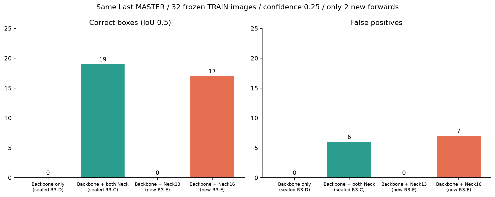
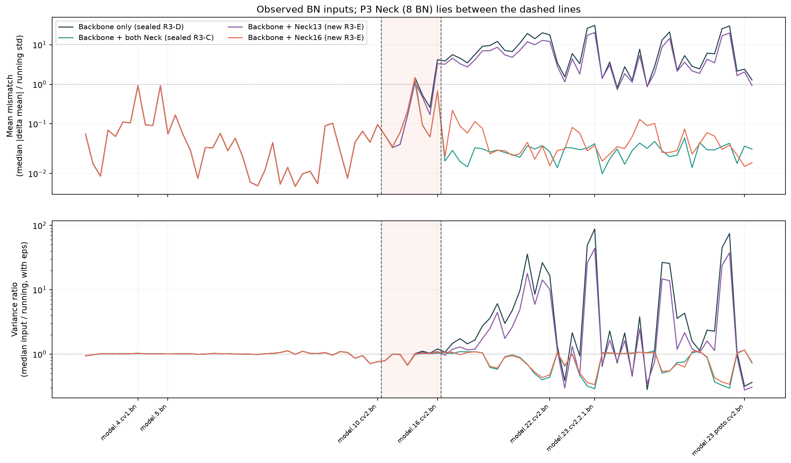

# Exp17-J2-R3-E：固定Backbone下的Neck13/16条件式Mean对照

状态：`EXP17_J2_R3_E_TWO_FORWARD_COMPLETE_PENDING_CHATGPT_GATE`。科学状态：`HOLD_NECK16_CONDITIONAL_RESCUE_TRAINING_ORIGIN_UNRESOLVED`。基线提交 `1f81ea295b39994c17701b8167f0cb3284a57bd0`。执行时间2026-11-24 16:51（Asia/Shanghai）。

## 结论

**在Backbone 0–10的BN Mean已纠正这一共同条件下，仅再纠正Neck16的4个BN Mean，即恢复17个正确Box、7个FP；仅再纠正Neck13的4个BN仍无正确检测。** 先前纠正Backbone＋Neck13＋Neck16的封存参照为19个正确Box、6个FP。

因此，Neck16获得明确的**条件式功能干预证据**。本轮没有测试“原始Backbone状态下只纠正Neck16”，不能省略共同的Backbone干预；也未证明故障唯一源于Neck16、其4个BN每个都必要，或Pair造成了训练失配。

本轮结束模块级定位，不自动继续逐BN扫描。已有证据支持BN统计来源参与近端推理失效；训练为何形成这种权重/统计组合仍未确定。正式Last MASTER Mask AP50–95=0、100 Epoch、2100更新和80次VAL记录全部保留。

## 两次调用与封存参照

两次均选择40个Backbone BN，加上模块13或16的4个BN，共44个；两组共有40个、各自独有4个。每组其余46个BN Mean、全部90个BN Variance使用原running值。选中Mean来自本次路径当前batch，未移植另一组的统计。

输入仍为冻结32张TRAIN、62GT，Last MASTER同一文件和state SHA；FP32、AMP/TF32关闭，七类一致。NMS IoU=.7、max_det=300，IoU=.5一对一Box匹配。下表不是Mask AP或VAL，两阈值来自同一次raw输出。

| Mean纠正范围 | 来源 | conf | 检测数 | TP | FP | FN |
|---|---|---:|---:|---:|---:|---:|
| Backbone | R3-D封存 | .25 | 0 | 0 | 0 | 62 |
| Backbone＋Neck13＋Neck16 | R3-C封存 | .25 | 25 | 19 | 6 | 43 |
| **Backbone＋Neck13** | **R3-E新增** | **.25** | **0** | **0** | **0** | **62** |
| **Backbone＋Neck16** | **R3-E新增** | **.25** | **24** | **17** | **7** | **45** |
| Backbone | R3-D封存 | .001 | 42 | 0 | 42 | 62 |
| Backbone＋Neck13＋Neck16 | R3-C封存 | .001 | 4903 | 53 | 4850 | 9 |
| Backbone＋Neck13 | R3-E新增 | .001 | 126 | 0 | 126 | 62 |
| Backbone＋Neck16 | R3-E新增 | .001 | 4916 | 53 | 4863 | 9 |

低阈值下GT最佳几何IoU均值（忽略类别）依次为0.01305、0.71734、0.06138、0.71932。Neck16干预同时恢复了较好的几何匹配，不是只出现更多框。低阈值仍有大量FP，不能省略。

Backbone＋Neck13的分类logit均值/最大值为−24.8214/−2.1857，Backbone＋Neck16为−16.5211/2.2336；联合参照为−16.6062/2.3520。17与19是同一批次上的计数差异，不是统计等价证据，亦不能换算成正式性能“恢复百分比”。

## 为什么这比仅观察偏差更有解释力

两组新增各记录90BN、8040通道。独立核验和离线比较确认：

- Backbone＋Neck13在进入Neck16以前的44个BN、4536通道，其六种输入/输出/选中统计矩与R3-C联合参照逐项严格相等；首个Neck16 BN的输入Mean/Variance也相等。
- Backbone＋Neck16的同一范围与R3-D Backbone-only参照逐项严格相等；首个Neck16 BN输入矩也相等。

所以可以构成两个条件匹配的对照：

| 固定上游条件 | 不纠正Neck16 | 纠正Neck16 |
|---|---|---|
| Backbone纠正、Neck13原running | R3-D：TP0/FP0 | R3-E：TP17/FP7 |
| Backbone和Neck13均纠正 | R3-E：TP0/FP0 | R3-C：TP19/FP6 |

两行均沿用相同模型、输入、精度和后处理，参考结果未重跑。它们支持Neck16 Mean干预在这两个上游条件下的功能作用；仍不是训练历史中唯一致因的证明。

以下描述量为 `|输入Mean − Running Mean| / sqrt(Running Variance + eps)` 的通道中位数：

| 位置 | Backbone-only | ＋Neck13 | ＋Neck16 | ＋Neck13＋Neck16 |
|---|---:|---:|---:|---:|
| `model.16.cv1.bn` | 1.47307 | 1.12451 | 1.47307 | 1.12451 |
| `model.16.cv2.bn` | 4.18112 | 3.31395 | 0.68243 | 0.67185 |
| `model.23.cv2.2.1.bn` | 30.84209 | 20.29673 | 0.02830 | 0.03133 |

进入Neck16的偏差并未被Neck16自身干预提前改变。差异体现在该模块内及其下游：仅加Neck13时，所列检测头BN输出RMS中位数为61.1841、输入/run方差比为43.9708；改为加Neck16时分别为1.78371、0.33519，接近联合参照的1.65890、0.29017。

所有Variance来源仍是原running值，但上游Mean干预会改变下游真实Variance。因此不能把上述方差变化误记成额外Variance干预，也不能只凭Mean中位数下降判断模型恢复。

## 身份、预算与验收

用户明确批准R3-E两次范围，独立工程授权据此物化，不主张额外外部签名。原方案原字节另存。私有脚本沿用R3-D，仅修改精确条件、目录、授权/账本标识和历史证据绑定；生产C1代码不变。

- Last MASTER文件SHA：`063e473cf0b878f105c85790be47332a30d8192e09a14ad28ab2180b85ba6e2d`；native state SHA：`d222a70d7570680459359a36a682312690b052cc10197f4916ec1df66492782f`。
- TRAIN packet SHA：`802114bde743ce7c58e997be279987148f33d91898d43b511ad5040939edd929`。原Protocol、Runtime、COCO/Manifest身份、Training/VAL授权、Claim/Seal、Checkpoint及旧账本不变。
- 552个受保护原件SHA一致。两次独立deepcopy，输入张量、权重、BN buffer、模块模式前后不变；未保存模型、未解码新图像。
- 22项CPU算术/范围/预算测试通过；preflight无模型构造、前向或CUDA初始化。42项独立完成核验通过，CPU从保存的NMS数组重算四组逐图匹配一致。
- BN输出矩最大带尺度保护残差约3.30e−5（Mean）、1.82e−6（Variance）；原gamma/beta/running统计与封存参照一致。
- 账本6行、2次ATTEMPT及2次COMMIT闭合，SHA `bcc1ae73ef0c430f0606d99f18e770dd620d0f60915184cfc3fcb0429c49cf4f`；构造器/合成前向0，剩余额度0，无自动重试。
- RTX3080Ti，严格确定性、`CUBLAS_WORKSPACE_CONFIG=:4096:8`；GPU峰值allocated1269120512字节。诊断及提交约11.88秒，进程约18.90秒；执行与独立核验正常退出、stderr为空，CPU unittest为正常22项PASS输出，无失败调用。
- 无backward、optimizer、校准、训练、VAL/TEST或新种子。R3-B至R3-E累计10次独立预算内的TRAIN诊断前向，与正式80次VAL分开。

机器身份见 [execution_bindings.json](results/exp17_j2_r3e_neck_conditional/execution_bindings.json)，核验见 [verification_summary.json](results/exp17_j2_r3e_neck_conditional/verification_summary.json)。原始记录、预测数组、脚本、授权、账本及日志保存在私有完整/审查包中。

## 阶段收束与后续研究

R2–R3的结论已经从“全零AP原因未知”推进到：BN统计来源改变可恢复TRAIN上的部分Box功能，Mean比Variance单独干预更有作用，共享前段足够，并进一步取得Backbone已纠正条件下Neck16的功能证据。**这说明权重并非完全不含可用检测信息；不说明正式VAL/Mask已恢复。**

尚未解释的是训练诱因：固定统计回放的梯度是否推动了主任务BN较不敏感的平移/尺度方向，权重持续变化与running统计跟踪是否失配，以及单batch诊断的泛化范围。原梯度汇总、裁剪率及buffer轨迹不足以直接作因果归因。

下一步应转入训练来源机制研究，停止模块级扫描。建议及所缺证据见 [训练诱因研究说明](results/exp17_j2_r3e_neck_conditional/TRAINING_ORIGIN_NEXT_STEPS_NOT_AUTHORIZATION.md)。该说明不授权新前向、反传、校准或重训；新机制实验必须先形成可审查的固定输入与调用预算。本轮交付后停止，旧G4未提交内容保留。
