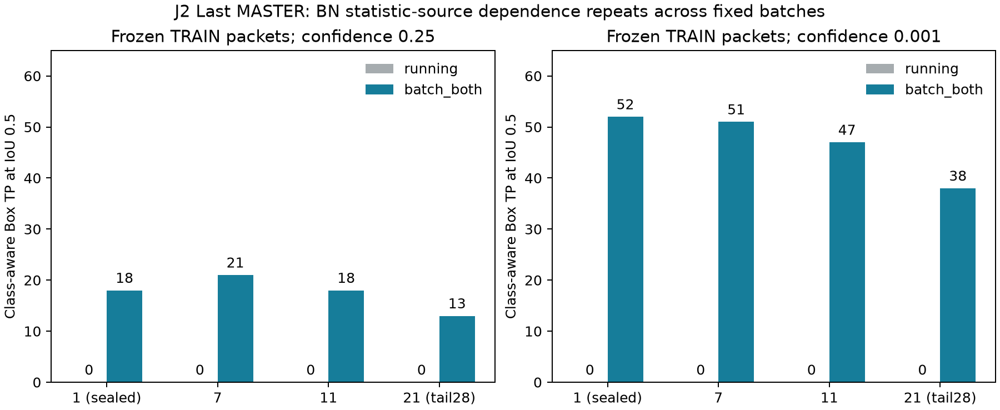
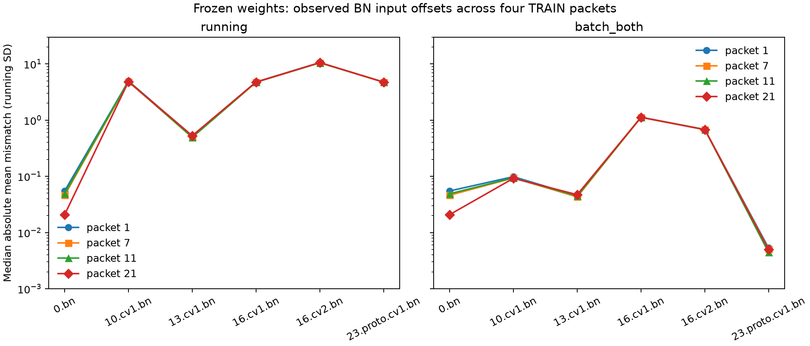

# Exp17-J2-R4-B：冻结权重跨批次 BN 统计对照

日期：2026-11-24（Asia/Shanghai）。前序：[R4-A机制设计](EXP17_J2_R4_A_TRAINING_ORIGIN_MECHANISM_HANDOFF.md)，依据提交 `b0b12af973cd19ca58d220057bf3a643877e30a4`。

状态：`EXP17_J2_R4_B_SIX_FORWARD_COMPLETE_PENDING_CHATGPT_GATE`。
科学状态：`HOLD_TRAINING_ORIGIN_UNRESOLVED_CROSS_BATCH_BN_MISMATCH_SUPPORTED`。

**三个预先固定的新 TRAIN 批次全部复现：同一 Last MASTER 权重使用原 running 统计时正确检测为0，使用当前批次统计时恢复正确检测。** 这将 BN 统计依赖从单批次观察推进到四个固定批次，削弱了“只对最初一批有效”的解释。训练为何产生这种失配仍未确定；不能据此认定 Pair、detach、Clip10 或 AdamW 是唯一原因。

## 1. 执行范围与保护

用户在 R4-A 交付及6次前向建议之后回复“继续进行”。据此完成本次诊断授权的工程落地，明确记录为用户许可，不声称存在另一个 ChatGPT 签名。原正式训练/VAL授权、Protocol、Runtime、原始 Checkpoint、Claim、Journal 和80次正式 pass均未改动。

实际新增调用严格为：位置7 running、位置7 batch-both、位置11 running、位置11 batch-both、位置21 running、位置21 batch-both。每次独立模型副本，完整 A 前向各1次；N、反传、优化器更新、构造器 stride/dummy forward、VAL、TEST 均为0。位置1的两份 R3-B结果只读复用，没有重新 Claim 或前向。没有执行 R4-C。

模型固定为 Epoch100 Last MASTER FP32，文件 SHA `063e473cf0b878f105c85790be47332a30d8192e09a14ad28ab2180b85ba6e2d`，native tensor SHA `d222a70d7570680459359a36a682312690b052cc10197f4916ec1df66492782f`。没有初始化新网络、加载新权重或保存校准模型。

四个 packet 是原 epoch000 的位置1/7/11/21；文件/六张量/归一化输入 SHA、TRAIN668成员资格和 ReplayTrace来源均核对。新批次为32/32/28张，保留尾批28张；共92张、168个增强后实例，两模式合计184次图像曝光。包括历史位置1后为124张互异来源、230个增强后实例。只消费封存张量，不解码原图、N或Valid，不重新增强。

所有 head 保持 eval。running 使用原 BN buffers；batch-both 在该次前向中用 functional BN 的当前 Mean/biased Variance，不更新持久 buffers。FP32、TF32关闭、严格确定性/CUBLAS设置；输入、模型权重/BN、模式、source非持久属性及RNG前后检查通过。新诊断目录、固定顺序账本、预留后提交及失败禁止重试保护均生效。

## 2. 检测结果：三个新增批次一致复现

口径：既定 conf=.25、class-aware Box IoU=.5匹配；NMS参数沿用冻结实现。这里只是 TRAIN 描述性计数，不是 Mask AP、VAL 或新的正式科研结果。

| 固定位置 | 图像/增强后GT | 原 running TP/FP | 当前 batch-both TP/FP | 来源 |
|---|---:|---:|---:|---|
| 1 | 32 / 62 | 0 / 0 | 18 / 6 | R3-B封存结果，只读复用 |
| 7 | 32 / 65 | 0 / 0 | 21 / 9 | 本轮 |
| 11 | 32 / 56 | 0 / 0 | 18 / 7 | 本轮 |
| 21 | 28 / 47 | 0 / 0 | 13 / 7 | 本轮，尾批 |
| 新增三批合计 | 92 / 168 | 0 / 0 | 52 / 23 | 6次新增前向 |
| 含历史四批合计 | 124 / 230 | 0 / 0 | 70 / 29 | 历史2结果＋本轮6结果 |

在既定低阈值 conf=.001 下，新增三批 running 共81个检测，全部FP；batch-both 为136 TP、12941 FP。含历史四批后 running 为0 TP/111 FP，batch-both 为188 TP/17546 FP。低阈值仍有大量误检，不能只展示召回而宣称性能已修复。它也说明原 running 的失效不能简单归结为“.25阈值太高”；本轮没有改阈值或评价规则。

batch-both 在新增三批低阈值输出中的平均最佳几何 IoU（忽略类别）分别约.6925、.7046、.6932；running 分别约.00165、.00076、.00276。这个量只辅助描述已有候选框的几何功能，不等同分类正确率或AP。

## 3. 实际 BN 统计：存在跨批次一致的偏移

保存每次90个BN、8040通道的输入/输出 Mean与biased Variance及原 buffers；结合两份历史结果共64320通道记录。按模式、层和通道独立汇总，观测权重为 `B×H×W`；合并方差包含批内方差和批次均值间方差，不能直接平均各批方差。不同模式改变下游输入，因此两模式不混合成一个分布。

定义归一化偏移 `z = (输入均值 − 原 running_mean) / sqrt(原 running_var + .001)`。下表均为四批按观测数加权后的通道汇总：

| BN / 统计路径 | 通道中位数 abs(z) | 原始均值偏差绝对值中位数 | 批间输入均值SD中位数 | 四批偏移同号通道比例 |
|---|---:|---:|---:|---:|
| Neck16 cv1 / running | 4.7409 | 16.7684 | .10228 | 100% |
| Neck16 cv1 / batch-both | 1.1227 | 4.0120 | .00573 | 100% |
| Neck16 cv2 / running | 10.5102 | 36.4519 | .10862 | 98.44% |
| Neck16 cv2 / batch-both | .6783 | 2.1757 | .00360 | 100% |

这表明：在这些固定输入上，原统计相对当前激活的差异有稳定方向；running 路径还会传播并放大上游失配。batch-both路径中 Neck16入口仍与原 running统计不同，即使上游已使用当前统计。

**这不是历史单步滞后的测量。** 上游 BN 归一化本就会压低某些批间均值变化；不能把“偏差/批间SD”的比值当作独立样本显著性，也不能用四批结果推算滞后了多少步。当前证据来自同一终点权重及原固定增强，不覆盖全部668 TRAIN或训练中的每一步。

上述结果与R3的Mean干预定位相容，但本轮使用全局 batch-both，没有在新批次重复 Mean-only 或 Neck16局部干预。因此不能说已证明所有新批次均由Neck16单独造成，也不能把全局对照当成局部必要性检验。

## 4. 验收和证据身份

- 25项针对性 CPU测试通过：32/28张输入、绑定/来源/trace错误、固定调用顺序、重复/未提交/失败调用、超时和统计合并算术。没有模型Smoke。
- 六个唯一 attempt与六个 commit组成14行哈希链；无失败/重试。新增前向数=6、synthetic=0、反传=0、optimizer=0、VAL/TEST=0。
- 93项独立CPU审计通过，包括12组阈值结果从保存NMS数组重新匹配、统计来源、90BN/8040通道、冻结权重/buffers、相同批次首层BN输入一致和输出SHA。
- 585个受保护文件SHA不变；原80次正式VAL记录及历史诊断账本不变。六次执行没有NMS超时或非有限值；运行stderr为空。
- 六次对照及内部收尾约31.45秒，进程总用时约40.79秒；峰值allocated显存1269121024 bytes（约1.18 GiB），低于10 GiB上限。
- 原始运行包已复制并校验：124869340 bytes，SHA `3aeb022f855eac14dac4439464fb48b94d3e1fea22becd609837999b3c7e4dc8`。诊断账本SHA `ecee168904540b4aa0b84829b33fa2348737d0160b4d7b6960b984efc97a9eb8`。

公开交付为结果表、统计汇总、图、身份索引及状态；原始逐通道记录、NMS数组、原始张量切片、运行脚本/授权/日志和验证记录在私有包中。最终图仅修改坐标排版，未重新执行模型。旧G4未提交改动保留，正式生产源码未修改。

## 5. 结论与下一步

当前可以更明确地说：**这套冻结 J2权重仍保留部分正确检测功能，但它与保存的 BN running统计不配套；该现象在预先选定的多个 TRAIN批次上重复出现。** 这为“训练Loss下降、eval全零”的模式差异提供了更强的近端解释。

仍缺少的是训练诱因：权重/激活漂移与统计跟踪、detach A统计改变的梯度方向、AdamW历史moments及Clip10可能共同作用，不能从本次无梯度对照分开。原 Last MASTER Mask AP50–95仍为0，相对J1 Seed42仍下降27.27438798549706 pp；没有校准后的VAL结果，也没有修改正式负结果。

建议下一步采用已提出的 **R4-C相同前向值、不同统计导数路径对照**，而非继续逐BN扫描或重新训练。范围保持单个完整Last MASTER＋projection、固定位置1；2次A全网＋2次N前缀、6次模型组件autograd，准备阶段另最多12次CPU小张量导数验收。需先证明两图前向相等，分开报告实际参数方向与虚拟通道平移方向；不得把终点即时梯度解释成整个训练历史。具体范围沿用 [R4-A设计](results/exp17_j2_r4a_mechanism_design/NEXT_DIAGNOSTICS_NOT_AUTHORIZATION.md)。

本轮6次预算已经完成并封存，停止于R4-B交付，不自动进入R4-C，不重新训练、不校准BN、不访问VAL/TEST或追加种子。
