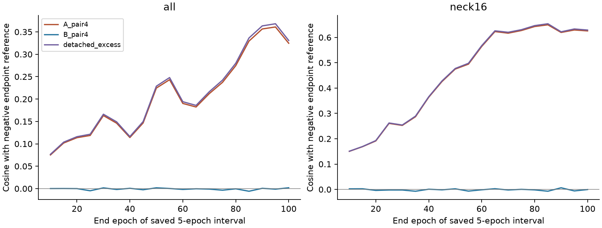
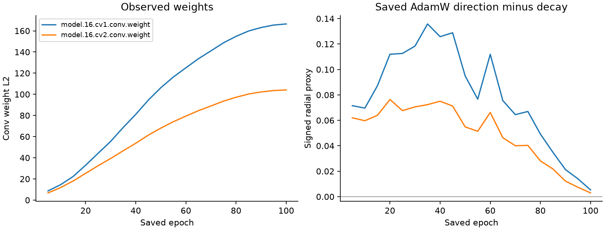
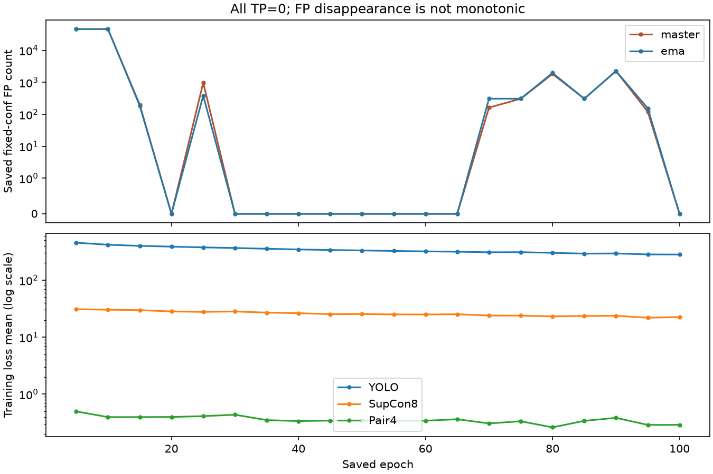

# Exp17-J2-R4-D：历史轨迹与终点统计梯度方向的离线对照

日期：2026-11-24（Asia/Shanghai）。依据R4-C v3提交 `93ece1d9aed59c8428a40f3894d4c6b8f2448b77`。用户回复“继续进行”，按前次交付建议继续离线时间顺序分析。

状态：`EXP17_J2_R4_D_OFFLINE_TEMPORAL_ANALYSIS_COMPLETE_PENDING_CHATGPT_REVIEW`。
科研状态：`DETACH_SCALE_DRIFT_MECHANISM_SUPPORTED_HISTORICAL_CAUSALITY_UNRESOLVED`。

**新证据使“detach统计导数与共享参数尺度漂移有关”成为更具体的优先机制：终点Detached Pair具有Connected中基本消失的卷积径向分量；该差异的下降方向与19个历史5轮区间的Neck16参数位移全部正向对齐。保存的AdamW方向也持续支持权重范数增长。** 这些是历史状态与终点向量的关联，尚不能确定它造成了最早的零AP或BN Mean失配。

本轮没有模型构造、模型前向、Autograd、Optimizer Update、BN校准、新VAL或TEST。原Last MASTER Mask AP50–95=0、80次正式VAL及全部原始实验记录保持原样。

## 1. 本轮新增范围

继承R3已完成的COCO初值、计数、EMA、BN/Conv分位数、Clip10及关联检查，不重新执行全量审计。

- 将20个正式评价时点、100轮训练、2100步、80个历史probe及选定BN/Conv/AdamW状态按时间关联。
- 只读22份完整Checkpoint：原104/105步及20份periodic。使用R3已绑定文件SHA；没有读取原始图像、生成增强或重新判定Pair。
- 将R4-C的真实参数梯度与历史参数位移、保存moments、自适应方向及参数径向作离线代数比较。294个可训练参数名称/形状与R4-C保持一致。
- 预定网络范围为全参数、Backbone0–10、Neck13、Neck16、Conv权重、BN γ/β和Projection。没有按结果追加层扫描或历史探针。

共享权重、完整Projection、科学参数和原身份不变。当前生产Source Catalog继承R4-C的 `3ccdfe26b414c9c5c6c45a1be93a9fa38210cae8c36bc7e1a8a8c227a7b30f42`；本轮没有加载生产模块或修改生产文件。

## 2. 精确定义：我们比较了哪个方向

R4-C终点固定TRAIN position1、FP32下的加权Pair梯度记为：

```
gA = 原Detached replay_a的Pair4梯度
gB = Connected-statistics surrogate的Pair4梯度
s  = gB - gA                 # 加入的A统计导数贡献
d  = gA - gB = -s            # Detached相对Connected多出的梯度
```

两张图原始下降方向之差是`-d`。历史参数位移`Δθ=θ_t−θ_previous`与`-d`计算cosine。私有原始方向表的`omitted_pair4`字段保存的是d；公开汇总统一称`detached_excess`，不能误读为s。

这是**在固定参数坐标中，用终点参考向量描述历史轨迹**。历史参数、输入批次、AMP、Clip10和AdamW都与终点诊断不同。我们没有重建历史组件梯度，没有把投影解释成“Pair贡献率”或“解释了多少BN漂移”。

保存AdamW状态的代数方向是`-lr*m_hat/(sqrt(v_hat)+eps)`，decay方向为`-lr*wd*θ_saved`。它使用当前保存参数与LR，不是实际执行的下一步；m/v包含所有联合裁剪后的历史梯度，不能按损失项拆分。终点optimizer来自训练batch21，R4-C来自固定batch1，也不能把两者当作同一步。

## 3. 真实参数位移与detach差异方向相容

以下均为Epoch5→10至95→100的19个区间，不包含重复105步状态之间的零位移。

| 参数区域 | cos(Δθ, −gA)中位数 | cos(Δθ, −gB)中位数 | cos(Δθ, −d)中位数 | 与−d正向区间 |
|---|---:|---:|---:|---:|
| 全参数 | .19019 | −.00039 | .19406 | 19/19 |
| Backbone0–10 | .14946 | −.00069 | .15309 | 19/19 |
| Neck13 | .29759 | −.00084 | .29804 | 19/19 |
| Neck16 | .49447 | −.00167 | .49782 | 19/19 |
| Conv权重 | .14545 | .00041 | .14910 | 19/19 |
| BN β | .49842 | −.00399 | .49866 | 19/19 |

Neck16与`-d`的余弦范围为.15084–.65389。两组独立保存量在方向上相容；Connected终点参考基本接近正交。全参数中，终点YOLO和SupCon8负梯度与历史区间位移的cosine中位数分别约.00003和.00019。

**接近正交不能证明YOLO/SupCon没有贡献。** 主任务方向可能随训练强烈旋转、相互抵消并经优化器预条件化；终点方向也可能是在已经漂移的权重下形成的结果。19个连续区间不是19个独立科研重复，不作显著性检验。



## 4. 从虚拟Mean平移推进到可实现的Conv尺度方向

径向cosine定义为`cos(−g, θ)`，正数表示该原始梯度下降方向会在一阶上增大实际参数范数。它是实际Conv weight空间的方向，不是没有bias的卷积无法独立实现的输入共同平移。

| 终点卷积权重 | Detached Pair径向cosine | Connected Pair径向cosine | Detached径向投影 | Connected径向投影 |
|---|---:|---:|---:|---:|
| model.4.cv1 | .56466 | 约.00007 | 4.919321 | .000025 |
| model.13.cv1 | .40919 | 接近0 | .147310 | 接近0 |
| model.16.cv1 | .60440 | 约.00005 | 3.674026 | .000013 |
| model.16.cv2 | .37298 | 约.00003 | 2.226425 | .000010 |

model.0 Conv并不遵循上述外向趋势：Detached径向cosine约−.00119。没有把局部观察推广为全网同一种行为。Neck16 cv1中，终点YOLO/SupCon8径向cosine也接近0。

这与BN对尺度方向较不敏感、detach破坏某些统计补偿的机制相容。有限epsilon、上下游网络和多层统计路径仍存在；不能宣称一个严格全网络尺度不变定理已经被证明。上表未乘clip系数、未经过AdamW，也不能直接等同实际更新量。

## 5. 历史保存的AdamW方向支持持续尺度增长

20个periodic时点，Neck16 cv1/cv2的保存自适应方向相对当时权重均为外向；扣除当前参数上的纯decay径向项后，20/20仍为正。

| 参数 | Epoch5权重L2 | Epoch100权重L2 | E5净外向proxy | E100净外向proxy |
|---|---:|---:|---:|---:|
| model.16.cv1.conv.weight | 8.7087 | 166.5070 | .071536 | .005290 |
| model.16.cv2.conv.weight | 6.7804 | 104.1343 | .061999 | .002931 |

Neck16 cv1的保存Running Mean绝对通道中位数从.9031增至996.1821。参数范数与buffer增长均为真实保存状态；**没有相应历史激活，就不能称这些保存量直接测到了当时的running/current-input失配**。

保存自适应方向与`-d`的cosine在Neck16的20个时点全部为正，中位数.40729；全参数中位数.11510。这个方向来自联合历史moments，不能分解出Pair、YOLO或SupCon的因果份额。Clip10仍是2100/2100触发；本轮没有新的“无裁剪”对照，不能认定Clip10独自导致尺度增长。



## 6. 时间表：最早失败、R1边界与FP反复出现

最早正式评价和完整Epoch边界是Epoch5、105步，第一次正式AP已经为0。另有原104步恢复状态，但没有Epoch1–4末的完整状态或功能对照，无法离线定位更早起点。warmup只覆盖更新1–63，64为首个非warmup，106为R1后首个继续更新。

早期梯度范数中位数：warmup1–63为452.58，64–105为179.83，106–126为175.00。这些汇总没有显示R1后立即突然变大的范数，但不构成全部运行时属性连续的独立证明。

Epoch5 MASTER两次评价在R1修复前已经产生全FP/零AP。该历史模型身份沿用R1接受的封存证据事后关联等级，不补写现场字段。Epoch5 EMA在R1 AUX恢复中使用105步状态补评；105次训练更新全部发生在修复前。因此R1隔离修复不能解释**最早已观察到的MASTER零AP起点**，并不表示早期与后期失败必然同因。

正式fixed/conf=.25输出不是单向消失：

| Epoch | MASTER FP | EMA FP | 两角色TP |
|---|---:|---:|---:|
| 5、10 | 每个时点46200 | 每个时点46200 | 0 |
| 15 | 201 | 186 | 0 |
| 20 | 0 | 0 | 0 |
| 25 | 975 | 383 | 0 |
| 30–65，每5轮 | 0 | 0 | 0 |
| 70 | 162 | 308 | 0 |
| 75 | 308 | 308 | 0 |
| 80 | 1826 | 1970 | 0 |
| 85 | 308 | 308 | 0 |
| 90 | 2257 | 2259 | 0 |
| 95 | 120 | 154 | 0 |
| 100 | 0 | 0 | 0 |

46200=154张×max_det300。上述是固定阈值pass的保存计数；standard表没有保存预测数量，不能用fixed数量代填。40个standard角色AP全0，40个fixed角色TP全0。

历史80个probe在所有20时点、四个固定批次中，选定的全参数及model0/4/10/13/16域均保存非零Pair4梯度。Epoch100训练Pair4平均约.2900、step内hinge活跃比例的平均约.4722。因此“Pair在中后期完全没有参与”不受支持；这仍不是历史connected/detached差分证据。



## 7. 科研判断与下一步

目前分开的证据链是：

1. **已确认近端问题**：终点多个TRAIN批次下，保存BN统计与正确检测功能不配套，Mean干预可在受测条件下恢复部分检测。
2. **已确认终点梯度机制**：detach明显改变Pair对真实共享参数的梯度；部分Conv外向尺度分量在连接统计导数后基本消失。
3. **新增历史相容性**：终点差分下降方向与历史Neck16位移、保存的AdamW方向持续正向对齐。
4. **尚缺的连接**：早期零AP是否同属BN Mean机制；detach差分在早期是否存在；它经真实优化器后是否推动实际激活均值偏离running跟踪。

因此，detach相关尺度动力学现在值得优先检验，仍不能下结论“已找到唯一根因”。没有发现新的“执行违背冻结协议”的证据；更像是需要验证的J2训练动力学机制，而不是已经证实的导出或评价bug。正式负结果继续完整保留。

**推荐下一轮先做Epoch5两次TRAIN前向：原running与Mean-only对照。** 它比继续堆叠终点梯度更直接地回答“早期失败与终点是否同因”。若早期不能被Mean干预恢复，应保留多阶段失效解释；若能，再申请Epoch5两图导数对照，检查detach机制是否在首个失败状态已存在。独立小预算方案见[R4-E提案](results/exp17_j2_r4d_temporal/R4_E_EARLY_MEAN_PROPOSAL.md)。本轮没有签发或消费其模型预算。

后续Epoch5两图梯度方案另有真实存储约束：R4-C v3约10.38GiB激活仍保留，当前约8GiB剩余空间不足以直接再建同等缓存并保留2GiB。不能自动清理旧缓存或复用其身份。两次无反传TRAIN前向不需要这份大激活缓存。

## 8. 验收与身份

- 22份Checkpoint及六份R4-C梯度原文件全部按已有SHA核验，连同reader/request共30项输入前后不变；8个表格输入及早期边界补充输入SHA不变。
- 895行幅度对照通过（五个参考方向共享同一历史幅度，共179个不同历史幅度约束）：用R3已有逐参数AdamW表、逐层Conv位移表交叉重算新reader输出。8项代数fixture通过。未重跑R3全量检查。
- CPU reader成功区间约41.25秒；构造、模型调用、functional Conv/BN、Autograd、Optimizer、save和CUDA保护计数全部0，CPU RNG不变。
- 第一版只读reader因遍历到无AdamW状态的冻结DFL参数停止，未进入模型或数值实验。第二版仅查询已批准294个可训练参数；两版源码/错误日志保留，不修改原Checkpoint或环境。
- 私有远端证据包12项，557720 bytes，SHA `46d76a67492cdc1aa455329f384b287621f6fc08f13e17a6cea4f296160bed24`；下载后所有成员SHA验证通过。4200行方向记录及9900行径向记录保留私有。
- 独立CPU分析、时间表及PNG来自保存张量/记录，科研图已做可视检查。公开聚合不含私有Checkpoint、授权或原始图像。旧G4未提交改动保留。

本阶段完成后停止，不自动追加模型调用、训练、校准、VAL、TEST或随机种子。
