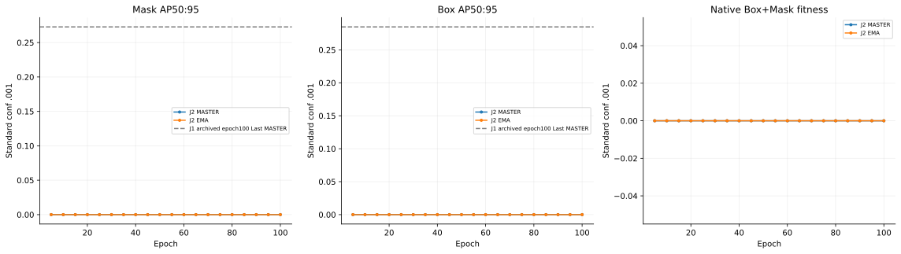

# Exp17-J2 Seed42：R1恢复后的完整正式训练交接

R2后续调查：冻结TRAIN同权重BN统计对照支持train/eval归一化失配近因；上游原因未决，正式VAL结果保持0。见[R2根因调查](EXP17_J2_R2_ROOT_CAUSE_REPORT.md)。以下保留原正式训练交接。

执行状态：**EXP17_J2_SEED42_FORMAL_TRAINING_COMPLETE_PENDING_CHATGPT_RESULT_GATE**。科学解释状态：**HOLD_UNEXPLAINED_ZERO_AP**。

100轮、2100次有效更新、20次VAL事件/80次native pass已真实完成，R1进程退出0。固定Epoch100 Last FP32 MASTER的Mask AP50–95为**0**，J1同Seed42/Last MASTER为**0.2727438798549706**，观测差值**−27.27438798549706个百分点**。全部40个MASTER/EMA标准评价角色的AP、P、R均为0。必须保留这个异常结果；目前未找到确定工程根因，不能将它直接归因于Pair或宣布方法已得到有效科研否定。

科学配置保持原G1：YOLO11n-seg、fresh COCO、Seed42、668 TRAIN/1266实例、521 Pair/345图/327组，640/Batch32，100epoch/2100更新，AdamW、AMP、Clip10、warmup63；SupCon8/Temperature.10、Pair4/Margin.20、BN replay_a。Last FP32 MASTER为主，Best与EMA独立；无TEST或追加seed。

## 执行与验收

| 项目 | 实际结果 |
|---|---|
| 训练 | 100完整epoch；2100attempt=2100commit=2100effective=2100EMA；AMP skip0 |
| 曝光 | 66,800原图；126,600增强前实例；每轮668图/1266实例、21批、尾批28 |
| 事务 | 100个AUX_COMMIT；无pending attempt/AUX；4408行Journal；无新硬门 |
| 评价 | 20事件、40角色、80唯一claim及80原始pass目录；未追加评价 |
| 梯度诊断 | 20组、80个既有固定TRAIN probe；无额外optimizer更新 |
| 保存 | 双槽完整Last、20份periodic、独立Best MASTER/EMA、两个Epoch100原生FP32端点 |
| 工程验收 | R1 CPU72PASS/0skip；结束后CPU tensor identities PASS；独立46项完整性检查全部PASS |

R1活动窗口为2026-11-23T16:11:23.912832Z至20:36:15.553748Z。原故障进程窗口860.861秒，R1窗口15,891.641秒，两窗口合计16,752.502秒；不含中间停机审查间隔。结束时刻换算UTC+8为2026-11-24 04:36:15。完整轨迹和账本保存在私有归档；公开[100轮汇总](results/exp17_j2_seed42_formal/completed_r1/epochs_sanitized.csv)、[2100步投影](results/exp17_j2_seed42_formal/completed_r1/updates_2100.csv)、[80次评价表](results/exp17_j2_seed42_formal/completed_r1/validation_overall.csv)。投影不替代原始持久Journal。

## R1恢复与身份

保留原105步Checkpoint、原recovery/latest、Journal前221行/57024字节、Formal/VAL Authorization、永久CLAIM、Execution Seal和原execution ID。原Protocol、Runtime Config、COCO和521 Manifest未变。Conv.default_act构造期所有权隔离修复保留原IsolationViolation和严格重载；安装框架未修改。

原MASTER两pass未重claim、未重跑；四个Epoch5 probe复用。仅补EMA standard/fixed两pass，生成两个角色Best和periodic，真实AUX5_COMMIT位于序号227；首次新attempt=106，此后完成1995次更新。历史MASTER证据继续标为POST_HOC_FROM_SEALED_ARTIFACTS；没有向旧evaluation.json倒填checkpoint SHA、role或confidence。

| 身份 | SHA256 |
|---|---|
| G1 Protocol | `613e4e154a872e0fd88791013f8e63716100470bb4a2f73084b702bb5cd37e44` |
| Runtime Config | `02f0f6548ee1cfd57af449fd1c9118417252b3a528273a1c80d2eee28c96d7b8` |
| C0原源码 | `86987123cffef957d7f639f0559e48f6c033562947ddd1ba64689ce6b8bbba4b` |
| C1修复源码 | `3ccdfe26b414c9c5c6c45a1be93a9fa38210cae8c36bc7e1a8a8c227a7b30f42` |
| Engineering Addendum | `73cb4d6f7250240e079f2596062507af690d057a454a4937e11eb74c8592e63e` |
| 521 Manifest | `fe6a36601c6c8d90cfddfc19ab58335552c18653b66f3535e84c97b4c222dc22` |
| fresh COCO | `55ed65c56c91713d23e8402371c6c49a6fd84f257f7dce452e8d70e41dcbe152` |
| 原105步文件 | `b8671bb8db32b40209020232478fa92e258e1d11681121d265323dc01553f83a` |
| 原Journal前缀 | `3b7ef98469bb0a45587e2dd73ee7abded1a1e712871388faa34c4862cd7576d7` |
| 最终Journal | `b394c00bf73b41316fc5fa4c3e721767efa0112d497c402bc05c32e2033f5d06` |

C0→C1/B0→B1通过独立Addendum记录，原105步不声称由C1产生。B1 Last/periodic位于同一output内recovery_r1_v1；原B0 store不覆盖。普通入口的pending AUX/源码绑定拒绝仍保留。工程细节见[R1交接](docs/exp17/EXP17_J2_R1_ENGINEERING_HANDOFF.md)。[105步原交接副本](docs/exp17/EXP17_J2_SEED42_UPDATE105_HARD_GATE_HANDOFF.md)与e57b9cb原始Git blob按字节相同；原工作区CRLF版本另存私有副本。

## 固定Last主比较及异常评价

standard使用conf=.001；fixed使用conf=.25、IoU=.5匹配。二者不混用，Best和EMA不替换Last主结果。标准P/R、Box/Mask AP50及AP50–95均为0。J1标准Mask P/R为0.5944994976911117/0.4793975586127764；J1 Box AP95为0.2847894100488274。完整未舍入结果见[整体比较](results/exp17_j2_seed42_formal/completed_r1/primary_J1_J2_overall.csv)和[七类比较](results/exp17_j2_seed42_formal/completed_r1/primary_J1_J2_per_class.csv)。

| 类别 | VAL GT | J1 Mask AP95 | J2 Mask AP95 | J1 Box AP95 | J2 Box AP95 |
|---|---:|---:|---:|---:|---:|
| Burn | 81 | 0.061374 | 0 | 0.110351 | 0 |
| Crack | 24 | 0.030078 | 0 | 0.059224 | 0 |
| Dent | 37 | 0.330177 | 0 | 0.365387 | 0 |
| Material missing | 32 | 0.357642 | 0 | 0.372628 | 0 |
| Tears | 10 | 0.521800 | 0 | 0.506710 | 0 |
| Tip curl | 3 | 0.451700 | 0 | 0.407000 | 0 |
| corrosion | 109 | 0.156437 | 0 | 0.172226 | 0 |

Epoch100 fixed时MASTER和EMA均0检测、Mask/Box TP0 FP0 FN296；J1 Last MASTER为154检测，Mask TP98 FP56 FN198、Box TP102 FP52 FN194。J2固定点Recall为0；0检测下TP/(TP+FP)为0/0，派生Precision为null，不能把FP减少解释成改善。tiny/small/medium/large GT为103/76/62/55，J2 Recall均0；J1为28/103、38/76、26/62、6/55。见[固定点计数](results/exp17_j2_seed42_formal/completed_r1/primary_J1_J2_fixed_conf025.csv)和[尺度表](results/exp17_j2_seed42_formal/completed_r1/primary_J1_J2_size_recall.csv)。

并非全程无预测：Epoch5和10的两个角色各有46,200个fixed检测（154×max_det300），全部FP；之后检测数波动，Epoch100回到0。所有事件的标准AP仍为0。原始standard结果没有独立预测数量字段，不能由AP0倒推无检测。两种Best均因fitness始终0和latest-tie规则选择Epoch100；这是机械选择结果，不能解释为恢复性能。

## Pair、梯度、BN及成本

49,762次Pair anchor曝光覆盖全部521 Polygon/345来源图/327组，Tip curl无准入Pair。训练均值YOLO由442.807降至280.632，SupCon由3.959降至2.808，Pair由.19237降至.07250。早期1–5轮d(A,B)/d(A,N)曝光均值为.05248/.10348，末20轮为.10736/.35589；辅助分支存在学习信号，但不证明语义有效，也不解释主任务的全零AP。

2100步全部触Clip10；unscale后preclip范数min/median/max为63.9367/146.2234/8556.2207，clip系数中位.068388。80个backbone probe的λ4 Pair/main范数比min/median/max为.01049/.07876/.49705；Pair–YOLO负cos52/80、Pair–SupCon8负cos44/80。postclip值仅公式推导；clip系数不是AdamW更新缩放的精确比例。Pair/main原比值乘4一次，N_P3梯度已含4，不再乘。去Pair代数参照不是重新训练的J1对照。**未改变Clip10或任何科研参数。**

每步A-BN进位1、N额外进位0、N不改变原生RNG的断言均通过；N梯度2100步均大于0。AMP skip/overflow0；step2000结束后scale由1增长至2，并非全程scale1。训练计时合计4182.137秒，中位每步1.940秒；峰值allocated6.716GiB、reserved7.090GiB。内部计时不含全部N准备、预取、checkpoint/fsync、VAL/probe成本；无匹配J1成本基线。

见[完整机制与裁剪报告](results/exp17_j2_seed42_formal/completed_r1/MECHANISM_AND_CLIPPING.md)。J1已封存VAL与G1要求中7项环境、12项评价字段及8项共享框架SHA一致；不声称证明同一物理GPU或J1全程训练AMP/硬件身份。

## 全零AP的只读排查与解释边界

未发现SupCon重复加入、输入重复/255、明显七类导出或评价接口合同错误；native持久张量与恢复状态一致，解码stride/anchor重建路径、Segment输出合同、FP32评估路径已静态核对。两个native端点的pickle元数据仅用zipfile/pickletools读取，未unpickle或新推理。详见[静态复核](results/exp17_j2_seed42_formal/completed_r1/ZERO_AP_STATIC_REVIEW.md)。

这些核对没有定位确定工程根因，也不能证明所有非持久运行时属性及推理行为均正确。**观察到的是完整运行下的灾难性评价退化；根因和科研可解释性未决。** 不把账本/哈希PASS等同于方法有效，也不为了得到非零结果更改参数、重跑评价或消耗超过80pass。计划内预算已耗尽。

## 模型、私有归档和交付

原生Last MASTER文件SHA=`063e473cf0b878f105c85790be47332a30d8192e09a14ad28ab2180b85ba6e2d`，canonical native state=`d222a70d7570680459359a36a682312690b052cc10197f4916ec1df66492782f`。EMA文件SHA=`506ed7c7341f05e072ea8283664206bf7b8d5804f1e8214fd79699ba4d930c94`，canonical state=`651c453e578c7084d4b333ec1b56488d2a0d3f60604852e08601e516b80bebe3`。文件SHA、canonical state、授权JSON digest分开记录。模型和20份periodic完整清单见[工件SHA表](results/exp17_j2_seed42_formal/completed_r1/artifacts.csv)。Best以独立FP32 tensor bundle、选择指针及历史receipt保存，不伪称原生Best导出。

主私有归档`exp17_j2_seed42_formal_completed_20261124T043621_v2.tar.gz`含739项自有代码/结果/Checkpoint/日志/私有授权，1,206,711,760字节，SHA256 `aa823d2b83a93921bf23252b56b5a542ee94e141e479fa114054ac7a1ce15c47`；服务器及Windows副本一致。原始图像、标签、epoch batch缓存和Python环境不进入归档。完整原始账本、日志、授权和大模型均保持私有；公开数据只含脱敏摘要、统计和身份。结束后离线比较脚本的一个字段名适配错误已版本化修正，原拒绝记录保留；未改生产源码、指标或原结果，未重跑tensor/summary/模型评价。

当前建议：**暂不追加Seed142/242**。先由独立Result Gate审查全零AP的实现与证据边界，再决定是否批准新的诊断实验；本次不自动修复第二个假设问题、不调参、不再推理、不访问TEST。正式训练已结束，进程不再运行。
