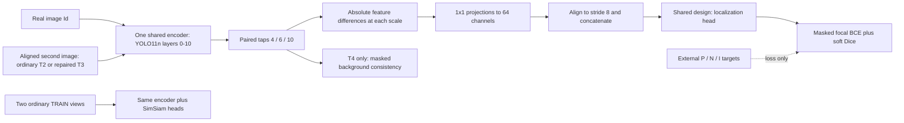

# Exp13.2-A1 Restoration-guided Multi-scale Local Defect Representation Learning

Status: `PROPOSED / NEEDS_IMPLEMENTATION_VERIFICATION`
Revision: Exp13.2-A1-R1, 2026-10-23 (Asia/Shanghai).

Design only. R1 repairs the specification after the user-relayed review `A1_DESIGN_REVIEW = CONDITIONAL_PASS / NEEDS_SPEC_REPAIR`. No training, inference, image generation, data modification, VAL/TEST image access, or trusted-pair freeze was performed. Original A1 evidence remains in Git history and the original handoff; this revision does not rewrite an experimental Gate.

## 1. Scope and evidence

H1 asks whether a restoration is a credible local pseudo-normal counterfactual; it remains unestablished. H2 asks whether its local difference improves defect-sensitive representation. H3 asks whether this improves downstream Mask mAP50-95 under a controlled protocol. Ir is a local pseudo-normal view, not a guarantee that the whole image is normal.

A0 contains 88 historical candidates from 20 independent sources: 15 promising, 2 uncertain, 3 restricted at source-level screening only. Current formally trusted/frozen pairs: **0**. No candidate has formal quality PASS. Pixel differences, smooth appearance, or source-level triage cannot substitute for variant review. Polygon-guided losses are annotation-assisted representation learning, not strictly label-free SSL.

Historical Exp12 is closed: single-seed42 frozen VAL Mask mAP50-95 A/COCO 0.298981, B/SimSiam 0.321897, C/Local Change 0.293530. These are reference results, not multi-seed or TEST generalization evidence.

## 2. Verified reuse boundary

The unchanged [code reuse audit](exp13_2_a1_code_reuse_audit.md) records actual Exp12 interfaces: `SimSiamSmoke`, TRAIN-only `TwoViewTrainDataset`, augmentation and stop-gradient cosine loss in `tools/ssl/exp12_simsiam_smoke.py`; `MultiScaleLocalChange.encode/forward` and `focal_dice_loss` in `tools/ssl/exp12_local_change.py`; and strict backbone injection/fairness audits in `tools/training/exp12_3_downstream.py` and `exp12_5_local_change_downstream.py`.

The restoration pair loader, ignore-aware localization loss, masked background loss, and artifact controls do not yet exist as an approved A1 implementation. All new mechanisms below are `PROPOSED / NEEDS_IMPLEMENTATION_VERIFICATION`.

## 3. Shared network and data flow

Only image tensors enter the encoder/head. Polygon, edit support, repair confirmation and validity masks are external supervision metadata.



For input `[B,3,512,512]` (B is unmeasured, not an approved batch):

| Layer | Stride | Channels | Feature tensor |
|---|---:|---:|---|
| 4 | 8 | 128 | [B,128,64,64] |
| 6 | 16 | 128 | [B,128,32,32] |
| 10 | 32 | 256 | [B,256,16,16] |

Use one parameter set: `Fd_l = E_l(Id)`, `Fv_l = E_l(Iv)`, `D_l = abs(Fd_l-Fv_l)`. Each projection is bias-free Conv1x1 -> GroupNorm(8,64) -> SiLU. Resize projected stride-16/32 features bilinearly to stride 8 with `align_corners=False`; concatenate to `[B,192,64,64]`. Head: bias-free Conv3x3(192,128) -> GroupNorm(8,128) -> SiLU -> Conv1x1(128,1), yielding `[B,1,64,64]`. Upsample logits, not thresholded predictions, to the aligned input grid for the primary loss.

This is the same proposed architecture for T2/T3/T4. Ordinary T2 augmentation changes color/brightness without moving or removing defects. Any future geometry is one shared transformation, never independent crops. The target in T2 still describes a true defect; it is not an assertion that ordinary augmentation repaired it.

The ordinary SimSiam branch uses pooled layer-10 features [B,256], projector 256->2048->2048->2048 and predictor 2048->512->2048, as audited in Exp12. Both localization passes backpropagate into the same encoder; SimSiam has its own specified target stop-gradient.

## 4. Common coordinates and three disjoint supervision regions

All definitions refer to a future, individually reviewed and frozen source/variant record. No such record is accepted in R1. Define on the common 512 grid Omega:

| Symbol | Meaning and required provenance |
|---|---|
| M | Transformed human defect polygon; annotation alone does not establish successful repair |
| C | Explicitly reviewer-confirmed repaired support for the selected real defect; never derived from MAE or the model prediction |
| B0 | Independently reviewed normal background in both real and repaired views; not simply the polygon complement |
| E | Transformed edit support, including its interior |
| H | Untrusted edit-boundary band and feather halo; conservatively includes resampling uncertainty |
| V | Shared valid correspondence/field of view; excludes padding, gray border and invalid mapping |
| U | Uncertain polygon boundaries, incomplete annotations, other unresolved defects, residual/ambiguous regions and crop uncertainty |
| G | Conservative guard around defect/uncertain support to avoid uncertain negative labels; radii require pre-registration |

Original RAW-to-historical-crop mappings must be verified first. Apply one recorded geometry g (crop, resize, optional flip) to both images and all polygon/validity/edit/region metadata. Rasterize transformed polygons conservatively; retain thin-pixel occupancy using supersampling/area coverage. Do not bilinearly blur class masks into implicit labels. Invalid areas grow conservatively under resampling. Record RAW crop coordinates and retained fraction; never infer repair of cropped-away defects.

Let `S = V minus (H union U)`. Define, with ignore taking precedence:

```text
P = S intersect M intersect C                         # Positive defect region
N = (S intersect B0) minus (M union C union G)          # Valid negative background
I = Omega minus (P union N)                           # Ignore / uncertain region
```

P, N and I partition Omega; pairwise intersections must be empty. N requires affirmative normal-background evidence; an unlabeled/other defect is not normal. For accepted source/variant records, unresolved residual defects trigger quality rejection, not rescue by selectively ignoring a failed repair.

The **interior of E is not globally excluded from localization**. P may lie inside E, and a reviewed normal interior may lie in N. Only H and independently untrusted parts are ignored. If boundary exclusions remove all P, flag the pair/transform unusable for localization; never convert it into a negative-only restoration pair. E, M, P, N, I and C must never be image channels, feature channels, attention inputs or head inputs.

T2 and T3 use exactly the same precomputed P/N/I from the same future trusted source record, including the same H/U restrictions. T2 does not get a larger negative area simply because it has no diffusion edit boundary. Metadata use in the losses is disclosed for both routes.

### Thin Crack at stride 8/16/32

The first version supervises the upsampled stride-8 fused logits on the full aligned grid, so no nearest-neighbor stride-32 target can silently erase a narrow crack. Do not erode the whole Crack to manufacture a core; if no reliably reviewed positive support survives, the record is ineligible.

For future per-scale diagnostics (not extra losses in version 1), use cell area fractions `p_l = area_pool(1_P)`, `n_l = area_pool(1_N)`, `i_l = area_pool(1_I)` at strides 8, 16, 32. Preserve any positive occupancy (equivalently a max-presence flag); report its fractional area and never label a positive-overlap cell negative. Conservative diagnostic rule: any ignored overlap -> ignore; else any P overlap -> positive-overlap cell; else all-valid N -> negative. Coarse positive-overlap flags are not claims that every pixel of a cell is defect. Report lost/ignored positive counts at every scale; if all positives are lost at a coarse scale, skip that scale's diagnostic, not the full-resolution target. Feature receptive-field overlap can still mix signals; the artifact audit is necessary.

### Pseudocode specification (not executable training code)

```text
require approved variant provenance and verified common coordinates
jointly map images and all metadata; derive V, H, U and guard G
derive P, N, I with ignore precedence; assert disjoint exhaustive partition
if correspondence invalid or transformed masks inconsistent: HARD_STOP
if count(P)+count(N) == 0: mark all-ignore; log; skip this source's L_loc
else if count(P) == 0 or count(N) == 0:
    mark auxiliary-ineligible; log; skip this source's L_loc
upsample shared-head logits to common grid; evaluate only on P union N
reduce each eligible source loss independently; then mean over eligible sources
if scheduled eligibility differs between T2 and T3: stop fairness comparison
if an auxiliary slot has no eligible sources: no encoder/decoder auxiliary step;
    do not count it as completed; stop and resolve before any formal run
```

Empty-P real restoration pairs cannot become background-only training examples; empty-N pairs cannot train positive-only localization. Partial-batch skips must be logged and cannot silently change planned exposure or update counts. A future authorized transform may be deterministically retried within a predeclared limit; persistent emptiness stops that source, without weakening quality rules. Ordinary SimSiam can remain defined on its separate valid TRAIN slots, but does not disguise a failed auxiliary gate.

## 5. Losses and normalization

`L = L_SimSiam + lambda_bg L_bg + lambda_loc L_loc`. Weights remain unapproved design variables; R1 does not tune them. Separate scheduled base/auxiliary slots are specified in the fairness protocol.

### L1: ordinary SimSiam

On the frozen TRAIN 668 set, use the symmetric negative cosine loss:
`L_SimSiam = -0.5 [cos(q(z1), stopgrad(z2)) + cos(q(z2), stopgrad(z1))]`.
Use two ordinary views and the audited projector/predictor. Preserve TRAIN-only path checks, finite/nonzero gradients, parameter updates, normalized feature std, embedding variance and collapse-patience checks. Augmentations and seed streams must be fixed before comparisons; pair geometry is handled separately from these independent base views.

### L2: background consistency (T4)

Use a stricter mask `B_bg = N minus (dilate(E) union dilate(M) union H union U)`. The entire edit support may be excluded **here**, because this term concerns unedited normal background; that rule must not be copied to L_loc.

At each feature scale, area-pool B_bg and require fully valid cells (fraction 1 within numerical tolerance), with a predeclared guard for contaminated receptive fields. Normalize each spatial feature vector `f_hat = f / max(norm(f), eps)`; compare both branches using `1 - dot(fd_hat, fv_hat)`. Divide by the number/weight sum of valid cells for that source/scale, then average nonempty scales and sources. Empty scale -> skip with count; empty source -> no L_bg for that source; an entirely empty T4 background batch stops T4's formal slot because T4 vs T3 would otherwise silently lose the intended term. Never use an epsilon to treat missing background as a measured zero. Nonzero background MAE is an audit risk, not a normality certificate.

### L3: masked focal BCE plus soft Dice

For a source, let `w_x = 1_P(x)+1_N(x)`, `y_x=1_P(x)`, `p_x=sigmoid(z_x)` and `Z=sum_x w_x`. Proposed initial focal constants follow the Exp12 reference (`alpha_pos=0.75, alpha_neg=0.25, gamma=2`), pending pre-registration, not fitted in R1.

```text
p_t = y*p + (1-y)*(1-p)
alpha_t = y*alpha_pos + (1-y)*alpha_neg
L_focal = sum_x w * alpha_t * (1-p_t)^gamma * BCEWithLogits(z,y) / Z
L_dice  = 1 - (2*sum_x w*p*y + eps) /
                 (sum_x w*p + sum_x w*y + eps)
L_loc   = L_focal + L_dice
```

Use stable BCE-with-logits on valid pixels; ignored logits are removed before reductions, not multiplied by zero after a possible NaN. Dice's prediction and target sums both use w. Epsilon stabilizes valid denominators only; Z=0 is skipped explicitly. Each eligible source has both P and N. Compute these per source, then mean by independent source, avoiding domination by large masks or many variants. Nonfinite valid logits are a hard stop. Positive-area and valid-area counts, focal/Dice components, per-term gradients and empty-region events must be reported.

Background, localization and SimSiam have different scales and may conflict. A future separately authorized smoke must measure encoder gradient norms and term-pair cosine alignment, head updates and collapse indicators. No ad hoc retuning or new triplet/SupCon objective is authorized. The scheduled base/auxiliary objective uses fixed slot frequencies as well as lambda weights; those frequencies and active head/optimizer states must be frozen and disclosed, rather than calling alternating steps identical to simultaneous joint-loss optimization.

## 6. Export, resource limits and fairness

Export only encoder layers 0-10; record state scope, source checkpoint, tensor counts and parameter hashes; reload must exactly match. Later downstream injection must preserve the same COCO-initialized neck/head and first-batch/fairness checks as Exp12.

Paired passes add activation memory; multiple heads/SimSiam slots and normalization state also matter. Historical topology was one approximately 22GB RTX 2080 Ti; current runnable batch, accumulation, precision and memory headroom are **UNMEASURED / SMOKE_REQUIRED**. Gradient accumulation does not repair inadequate BatchNorm microbatch statistics. No resource feasibility is claimed.

See the [fairness protocol](exp13_2_a1_fairness_protocol.md) for identical T2/T3 architecture, source/annotation exposure, optimizer budgets and artifact controls.

## 7. Historical crop note and current state

A0-QA flags Crack 470 crop risk while the spatial report records retained fraction 1.0 for both variants. Retain both historical statements; require explicit coordinate/field-of-view verification before any pair admission. A retained fraction of 1.0 alone does not settle all crop or structure concerns. A0 originals remain unchanged.

The proposed exploratory minimum is at least 10 independent trusted sources, Crack and corrosion each at least 5; it is pending user approval and is not statistical sufficiency. Currently 0 are formally trusted. Insufficiency pauses the two-class experiment; a narrower design needs separate review and never automatic training.

`EXP13_2_A1_R1_DESIGN_READY_FOR_CHATGPT_REVIEW`

```text
EXP13_2_A1_DESIGN_FROZEN = NO
FINAL_TRUSTED_PAIR_FREEZE = NO
RESTORATION_QUALITY_GATE_PASS = NO
EXP13_2_B_AUTHORIZATION = NO
SSL_AUTHORIZATION = NO
```

A1 design approval is not Data Quality PASS; Data Quality PASS is not training authorization; smoke PASS is not formal SSL authorization. TEST is never used for tuning at any stage.
